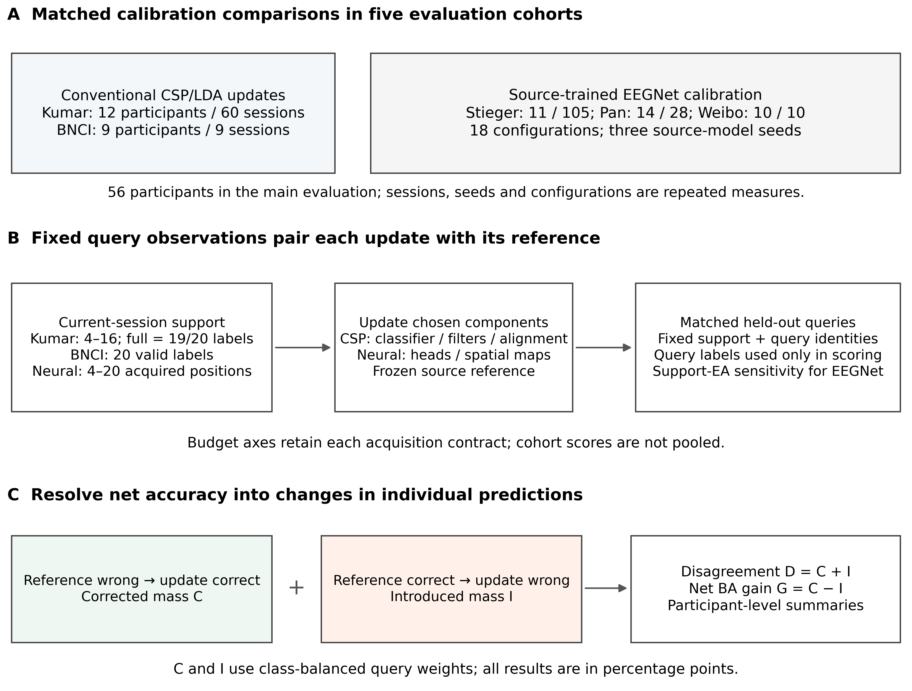
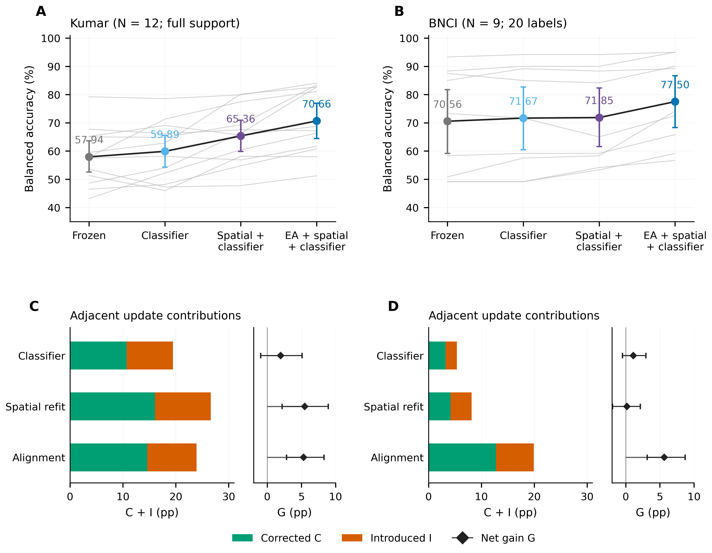
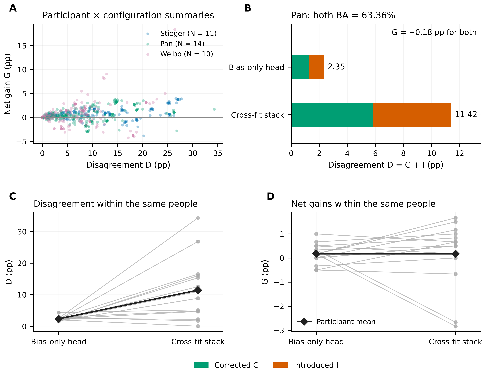
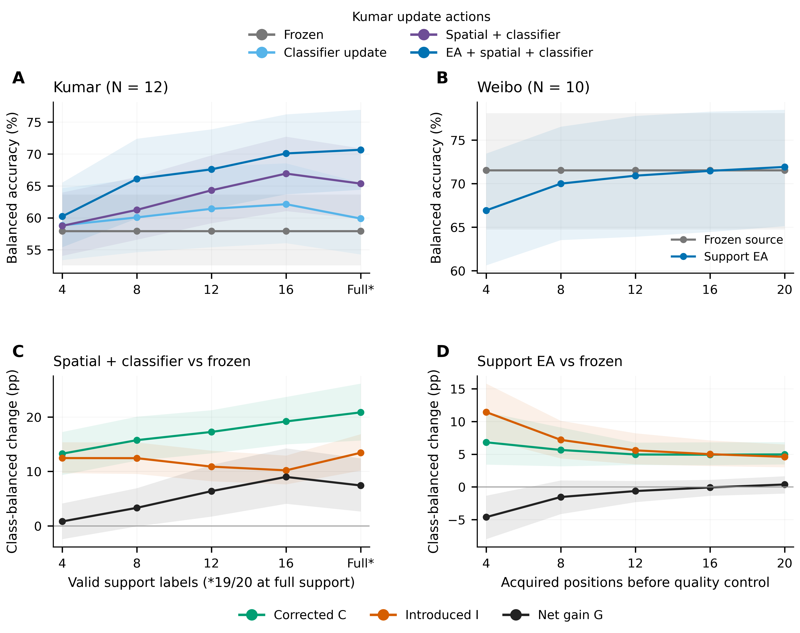

# Error redistribution across conventional and neural motor imagery EEG recalibration

**Ziyuan Zhu\*, Sihao Liu and Haoyang Yu**

College of Artificial Intelligence Medicine, Chongqing Medical University, Jinyun Campus, 61 Daxuecheng Middle Road, Shapingba District, Chongqing 401331, China

\* Corresponding author: Ziyuan Zhu; College of Artificial Intelligence Medicine, Chongqing Medical University, Jinyun Campus, 61 Daxuecheng Middle Road, Shapingba District, Chongqing 401331, China; e-mail: zzy2630816871@gmail.com

Sihao Liu: liu3100853087@gmail.com; Haoyang Yu: jiaguca3329@163.com  
Ziyuan Zhu ORCID: <https://orcid.org/0009-0005-1153-4926>

**Running head:** Error redistribution in EEG recalibration

## Abstract

**Objectives:** To characterize the corrected and introduced errors underlying accuracy changes after classifier, spatial-filter and alignment updates in motor imagery EEG recalibration.

**Methods:** A retrospective paired analysis evaluated four conventional pipelines and 18 neural configurations in five cohorts, comprising 56 participants in the main evaluation. Fixed queries supported study-specific budgets of 4–20 valid labels or acquired positions. Class-balanced error transitions were measured against frozen references, with component contrasts and alignment-reference sensitivity analyses. Cancellation was separated within participant summaries and between participants.

**Results:** Full CSP/LDA refitting in Kumar corrected 20.85 percentage points of errors and introduced 13.43 points, giving a net gain of 7.42 points. Spatial refitting beyond classifier-only updating corrected 16.04 points and introduced 10.57 points, yielding 5.47 points. In Pan, two neural configurations both achieved 63.36% balanced accuracy, with label disagreement of 2.35 versus 11.42 points. Across 48 neural configuration–cohort cells at 20 positions, median disagreement was 9.52 points and median net gain 0.68 points. Alignment profiles varied across cohorts and calibration budgets.

**Conclusions:** Decoder operations, prediction exchanges and participant variation jointly explain calibration outcomes. Reporting corrected and introduced errors reveals substantial differences concealed by net accuracy.

**Keywords:** brain–computer interfaces; decision stability; error transitions; participant variability; transfer learning

## Introduction

A short calibration recording must support a concrete decision about an EEG decoder: which parts should be updated, and what happens to the decisions that the decoder already makes? New labels can recalibrate a classifier, relearn spatial filters or estimate a transformation between recording domains. Each operation can correct existing errors and introduce new ones. Its balanced-accuracy gain records the difference between those two changes. Understanding the update therefore requires both its net benefit and the prediction exchanges that produce that benefit.

This distinction matters in repeated motor-imagery brain–computer interface use. Decoding performance varies across participants and recording sessions, while calibration itself consumes time and attention [@lotte2018; @sannelli2019screening]. Common spatial patterns and linear discriminant analysis (CSP/LDA) provide a transparent setting for separating representation and classifier updates [@ramoser2000; @blankertz2008]. Recalibrating LDA changes the decision rule in an existing feature space; refitting CSP and LDA also changes the spatial projection. Adaptive classifiers, spatial filtering and covariance alignment offer established ways to address session variability [@vidaurre2011lda; @arvaneh2013dsa; @he2020]. Compact neural decoders provide another useful setting: a source-trained representation can be retained while target-session information changes spatial transformations, classifier parameters or residual predictions [@lawhern2018].

Comparing an updated decoder with its frozen source model measures the total effect of the calibration pathway. A matched-label component contrast asks a more specific question. If two updated pipelines receive the same source and target labels, their difference can locate the contribution of the additional spatial or alignment operation. The associated prediction transitions then show how that contribution is realized: how many class-balanced errors were corrected, how many previously correct decisions became errors, and whether those exchanges occurred in the same participants. The component contrast and the transition analysis answer complementary parts of the calibration question.

Prediction churn and errors introduced during model replacement are established concerns in machine learning [@fard2016churn; @yan2021congruent]. Applying that perspective to EEG recalibration connects model updates to a finite recording budget and repeated observations within people. Equal mean accuracy can accompany very different amounts of label disagreement, while a positive mean gain can contain substantial opposing changes. Participant-level summaries add another distinction: corrected and introduced errors can offset within a person's repeated evaluations, and the remaining positive and negative gains can offset across people. An average score collapses both levels.

The calibration budget must also preserve what was actually acquired. A cap on valid labels and a cap on acquired trial positions represent different information costs when quality rejection removes trials. Evaluating the scheduled prefixes on fixed later query observations keeps the comparison focused on calibration information. Similarly, the scoring reference determines which part of the update is measured. A frozen decoder precedes target-session calibration; a support-aligned reference already incorporates target signals [@he2020; @junqueira2024ea]. Reporting both separates the total prediction change from the changes added beyond alignment.

Two observations illustrate the empirical opportunity. In Kumar, full CSP/LDA refitting gained 7.42 balanced-accuracy percentage points over the frozen decoder, comprising 20.85 points of corrected errors and 13.43 points of introduced errors. In Pan, a bias-only neural head and a cross-fitted selection stack both attained 63.36% balanced accuracy, yet their class-balanced label disagreement with the frozen decoder was 2.35 and 11.42 points. These examples motivate a joint assessment of the update operation, the magnitude of its prediction changes and their distribution across participants.

Here, we characterize that relationship across conventional and neural motor-imagery EEG recalibration. Matched conventional comparisons separate classifier recalibration, spatial refitting and support-only alignment. An eighteen-configuration neural grid extends the transition analysis across three cohorts and five acquisition budgets. Together, the main comparative frame covers five evaluation cohorts and 56 participants, with development results and a separate source-model replacement analysis retained in the supplement. The empirical contribution is an empirical account of how calibration gains arise from corrected and introduced errors, how their cancellation is distributed within and between participants, and how the observed balance changes along the recorded calibration prefixes.

## Materials and methods

### Comparative design and evaluation cohorts

We conducted a retrospective, participant-paired analysis of completed binary left- versus right-hand motor-imagery EEG evaluations. Five cohorts supplied the main analysis: 12 Kumar participants, nine BNCI2014-001 participants, and 11 Stieger, 14 Pan and ten Weibo participants [@kumar2024; @nemar177; @tangermann2012; @stieger2021; @pan2023; @yi2014]. These 56 dataset participants contributed distinct cohort-specific endpoints. Six Kumar development participants were summarized separately. A source-model extension used 85 Dreyer participants and zero target-calibration labels [@dreyer2023]. Source-model replacement and target calibration retained separate analysis roles.

The conventional-decoder evaluation compared update components within Kumar and BNCI. The neural-decoder evaluation compared 18 recorded calibration configurations within Stieger, Pan and Weibo. All contrasts paired methods on the same cohort-specific query observations. Recorded preprocessing, source training and participant partitions defined each evaluation; cohort estimates were reported separately. The Stieger partition contained 40 training-reference, 11 development-validation and 11 historical test participants. Neural evaluation cohorts had prior development exposure. This reanalysis retained their saved outputs and configurations without new fitting or query-driven selection.

### Conventional decoder updates

Kumar2024 contains 18 participants and six sessions. Participants sub-1, 4, 7, 10, 13 and 16 formed the development group; the remaining 12 formed the primary analysis cohort. Common-average-referenced 22-channel signals were filtered at 8–30 Hz and resampled to 128 Hz. Complete cue-anchored five-second epochs contained 22×640 samples [@kumarcodebook; @jayaram2018]. Session 0/runs 0–1 supplied 40 source-training trials. Each subsequent session supplied its first run as support and subsequent whole runs as query. Prefixes contained 4, 8, 12, 16 or the complete 19/20 valid support labels, with query identities fixed across budgets. Single-class prefixes were retained. Of 90 participant/session cells, 14 had 19 full-support labels and 76 had 20.

Frozen decoding fitted four-component common spatial patterns (CSP) and linear discriminant analysis (LDA) on source training. LDA-only updating retained source spatial filters and refitted LDA on source plus support; full updating refitted both on the same union. Covariance alignment separately whitened source and support signals before full CSP/LDA refitting. Kumar CSP used Ledoit–Wolf regularization and LDA automatic shrinkage [@ledoit2004]. Alignment operated in the 21-dimensional common-average-reference subspace using each domain's mean trial covariance. Query transforms used the support reference fixed before evaluation.

BNCI used 22 EEG channels with the recorded reference and cue-relative [0,4) s epochs at 250 Hz after run-wise 8–30 Hz filtering. First-day runs 1–4 supplied 96 hand-imagery source trials. The next day's first run supplied its first 20 chronological hand trials as support; the remaining four were withheld. Runs 2–6 supplied 120 query trials per participant, 60 per class. Its separately versioned implementation used four CSP components and covariance/LDA shrinkage 0.1. All updating pipelines shared the same fitting labels within each dataset. BNCI was also a neural source-training dataset; its conventional evaluation characterizes that pipeline's component contrasts.

### Neural calibration and acquisition budgets

The neural evaluation comprised 105 Stieger sessions, 28 Pan sessions and ten Weibo sessions. Inputs used FC3, FC4, C5, C3, C1, Cz, C2, C4, C6, CP3 and CP4. Common-average referencing, fourth-order 8–30 Hz bidirectional filtering and resampling to 128 Hz produced a one-second 11×128 crop, 0.25–1.25 s after the task anchor. Stieger's anchor occurred 2 s after cue onset. Trials were temporally demeaned and divided by their joint channel–time root-mean-square amplitude.

EEGNet source checkpoints were trained on BNCI2014-001, Cho2017, Lee2019 and PhysioNet MI with three seeds [@lawhern2018; @cho2017; @lee2019; @goldberger2000]. The 18 configurations covered frozen and aligned references, head updates, joint spatial/head updates, protected spatial updates, cross-fitted selection/stacking, bounded geometry and anchored residual controls. Saved method identities, initialization and fitting anchors were retained. Target batch-normalization and dropout states remained in evaluation mode.

Neural support budgets counted the first 4, 8, 12, 16 or 20 acquired positions. Rejected trials consumed positions without replacement. Query observations were fixed after position 20; Stieger additionally excluded the remainder of its boundary run and evaluated subsequent complete runs. Pan and Weibo used published trial order. Neural alignment averaged trace-normalized support covariances in the ten-dimensional common-average subspace, applied 5% isotropic shrinkage, whitened the estimate and recolored it to a fixed source reference. Where required, feature references came from the 40 Stieger training-reference participants. No query statistics updated these references.

### Prediction transitions and component contrasts

For query label \(y_j\), class count \(n_c\) and weight \(w_j=1/(2n_{y_j})\), balanced accuracy (BA) is the weighted correct-prediction sum. Relative to reference \(a\), we measured corrected errors and introduced errors as

\[
C=\sum_jw_j\mathbf{1}\{\widehat y_{aj}\ne y_j,\widehat y_{mj}=y_j\},\qquad
I=\sum_jw_j\mathbf{1}\{\widehat y_{aj}=y_j,\widehat y_{mj}\ne y_j\}.
\]

Class-balanced disagreement was \(D=C+I\), and net gain was \(G=C-I=BA_m-BA_a\). Values are reported in percentage points. These prediction-change measures connect to prediction churn and negative flips [@fard2016churn; @yan2021congruent]. The frozen source decoder was the principal scoring reference. Additional matched component contrasts compared full with LDA-only updating and alignment with full updating. Neural sensitivity analysis used support alignment as the scoring reference while preserving each method's fitting anchor.

Participant summaries averaged sessions equally and, for neural evaluations, averaged the three source seeds. With participant values \(C_i,I_i,D_i,G_i\), total cancellation decomposed exactly as

\[
\overline{D}-|\overline{G}|=
\operatorname{mean}_i[2\min(C_i,I_i)]
+\operatorname{mean}_i|G_i|-|\operatorname{mean}_iG_i|.
\]

The first component describes cancellation within participant summaries, including their session/seed averaging. The second describes cancellation between participant net changes. Fractional components divide by \(\overline{D}\); zero-disagreement ratios remain undefined.

### Statistical analysis and reproducibility

The participant was the independent resampling unit within each cohort. Pointwise 95% percentile intervals used 10,000 paired participant-bootstrap draws, seed 20261029, conditional on the recorded session/seed summaries. All scheduled methods and budgets were retained. New transition and cancellation analyses were descriptive, without additional hypothesis tests or a pooled cross-cohort effect.

Archived endpoint tests retained their original comparison roles and multiplicity families. Kumar full-minus-frozen was the original primary contrast and full-minus-LDA-only secondary; BNCI full-minus-LDA-only was primary. The supplement preserves the historical intervals, tests and separate neural inference families alongside the new descriptive intervals. Query IDs, labels, source-table hashes and the transition identities were checked before analysis. Code regenerates the tables and figures from saved predictions or their verified participant summaries; no additional model training or inference was performed.

## Results

### Evaluation coverage and paired prediction records

The main comparative frame contained 56 participants in five cohorts and 212 target sessions (Table 1). Conventional analyses paired four pipelines on fixed later-session queries; neural analyses retained all eighteen configurations and five scheduled acquisition budgets. Kumar's six development participants contributed 30 additional target sessions and were summarized separately. The source-model extension retained its own 85-person cohort.

The conventional input contained 78,600 Kumar prediction rows covering 3,930 distinct target trials and 36 BNCI prediction files covering 1,080 target trials. Methods and budgets matched exactly on ordered query IDs and labels within participant/session. The neural source table contained 3,150 participant–configuration–budget records; two scoring references produced 6,300 paired summaries. These repeated records preserve the participant units in Table 1. The identities C−I=BA difference and C+I=D held throughout the analysis.

**Table 1. Cohorts and information budgets in the main evaluation.** Sessions are target recordings within participants; labels, sessions, seeds and methods do not increase the independent participant count.

| Cohort | Decoder evaluation | Participants | Target sessions | Calibration unit |
| --- | --- | --- | --- | --- |
| Kumar | Conventional | 12 | 60 | 4/8/12/16 valid labels; full 19/20 |
| BNCI2014-001 | Conventional | 9 | 9 | 20 valid labels |
| Stieger | Neural | 11 | 105 | 4/8/12/16/20 acquired positions |
| Pan | Neural | 14 | 28 | 4/8/12/16/20 acquired positions |
| Weibo | Neural | 10 | 10 | 4/8/12/16/20 acquired positions |

Kumar development participants and the zero-target-label source-model extension are reported separately. Neural source checkpoints used BNCI among their training datasets; the BNCI row identifies a conventional pipeline evaluation. Budget units retain their cohort-specific definitions.

{width=95%}

**Figure 1. Study design and paired prediction analysis.** Five cohorts comprise 56 participants in the main evaluation. Conventional CSP/LDA actions and source-trained EEGNet calibration configurations retain their separately defined signal processing, fitting and acquisition contracts. Each update is evaluated on the same queries as its within-cohort reference. Class-balanced corrected errors C and introduced errors I give total prediction disagreement D = C + I and net balanced-accuracy change G = C − I. Sessions, source seeds and configurations are repeated observations within participants. Kumar budgets count valid support labels, whereas neural budgets count acquired positions before quality control. Six previously exposed Kumar development participants and the source-model extension are reported separately.

### Component comparisons locate the prediction changes behind net gains

Kumar frozen CSP/LDA achieved 57.94% BA, classifier-only recalibration 59.89%, full refitting 65.36% and alignment followed by full refitting 70.66% (Figure 2). Full refitting corrected 20.85 pp of source errors while introducing 13.43 pp, giving +7.42 pp net gain [+2.64, +12.42]. Its 34.28-point disagreement was substantially larger than the final score change.

The matched-label spatial-refitting increment beyond classifier-only updating comprised 16.04 points of correction and 10.57 points of introduction, yielding +5.47 points [+2.16, +8.92]. This increment represented 73.7% of the mean full-minus-frozen gain. Alignment beyond full refitting corrected 14.61 points and introduced 9.32 points, adding +5.30 points [+2.82, +8.31]. Each successive operation therefore had a distinguishable error-transition profile under the same source and target fitting labels.

BNCI displayed a different component balance. The spatial-refitting increment was +0.19 points [−1.94, +2.13]: 4.17 corrected versus 3.98 introduced points. Alignment beyond full refitting produced 12.78 corrected and 7.13 introduced points, adding +5.65 points [+3.15, +8.70]. All nine participant alignment differences were positive. The contrast identifies the added alignment operation within that conventional protocol; the full processing paths differ across cohorts.

**Table 2. Error transitions in conventional decoder updates at full support.** C: corrected errors; I: introduced errors; D: class-balanced disagreement; G: net BA change. Intervals are the new exploratory pointwise participant-bootstrap intervals, with no additional hypothesis tests.

| Cohort | Matched comparison | C, pp | I, pp | D, pp | G, pp [95% interval] |
| --- | --- | --- | --- | --- | --- |
| Kumar | Classifier − frozen | 10.70 | 8.75 | 19.46 | +1.95 [−0.97, +5.08] |
| Kumar | Full − frozen | 20.85 | 13.43 | 34.28 | +7.42 [+2.64, +12.42] |
| Kumar | Full − classifier | 16.04 | 10.57 | 26.61 | +5.47 [+2.16, +8.92] |
| Kumar | Aligned full − full | 14.61 | 9.32 | 23.93 | +5.30 [+2.82, +8.31] |
| BNCI | Classifier − frozen | 3.24 | 2.13 | 5.37 | +1.11 [−0.46, +2.96] |
| BNCI | Full − frozen | 5.56 | 4.26 | 9.81 | +1.30 [−1.76, +3.98] |
| BNCI | Full − classifier | 4.17 | 3.98 | 8.15 | +0.19 [−1.94, +2.13] |
| BNCI | Aligned full − full | 12.78 | 7.13 | 19.91 | +5.65 [+3.15, +8.70] |

Kumar full support contains 19 or 20 valid labels; BNCI support contains exactly 20. Historical endpoint intervals, primary/secondary roles and multiplicity adjustments are preserved separately in the Supplementary Materials. Frozen pipelines receive no target labels; the updating pipelines share source/support fitting examples within each cohort.

{width=95%}

**Figure 2. Accuracy and prediction changes along conventional update operations.** A–B: participant trajectories (grey) and participant-equal cohort means for frozen CSP/LDA, classifier-only recalibration, spatial-filter and classifier refitting, and refitting after support-only Euclidean alignment. Kumar uses its full current-session support run of 19/20 valid labels; BNCI uses exactly 20 valid labels. Error bars are pointwise 95% participant-bootstrap intervals from 10,000 resamples. C–D: adjacent-operation comparisons isolate classifier versus frozen decoding, spatial refitting versus classifier-only recalibration, and alignment versus full refitting. Green and orange bars partition prediction disagreement into corrected and introduced class-balanced mass. Separate black diamonds show their net gain and pointwise intervals. The updating pipelines share source/support fitting labels and all four pipelines share query identities within each cohort; frozen decoding uses no target labels. The cohorts retain different preprocessing and fitting implementations.

### Identical neural mean accuracy concealed different prediction exchanges

The Pan bias-only head and cross-fitted selection stack both attained 63.36% BA, relative to 63.18% for the frozen source (Figure 3). Bias-only updating corrected 1.26 pp and introduced 1.08 pp; the stack corrected 5.80 and introduced 5.62 pp. Both consequently gained 0.1786 pp, while disagreement was 2.35 versus 11.42 pp, a 4.87-fold difference. The identical observed means describe this matched-score example, without establishing equivalence.

Participant outcomes also differed. Bias-only calibration improved nine participants and reduced BA in three, with two unchanged. The stack improved ten and reduced BA in three, with one unchanged. Paired participant plots retain the amount of disagreement alongside each net gain, showing which people contributed to the shared cohort mean.

{width=95%}

**Figure 3. Equal mean accuracy with different prediction changes.** A: participant-by-configuration summaries for all seventeen non-frozen neural configurations at 20 acquired positions, relative to the frozen source. Configuration repetitions do not increase the 11 Stieger, 14 Pan or 10 Weibo participants. B: bias-only calibration and the cross-fitted stack in Pan both attain mean BA of 63.3571% and net gain of +0.1786 percentage points, while their disagreement is 2.3452 and 11.4167 points. C–D: disagreement and net gain for the same fourteen participants; grey lines connect participant pairs and black diamonds indicate participant-equal means. The shared observed mean is an illustrative matched-score case, not a statistical equivalence result.

### Complete neural comparisons separate within-person and between-person cancellation

Across sixteen non-anchor configurations in each of three cohorts at twenty acquired positions, median disagreement against the frozen source was 9.52 pp (IQR 4.80–12.79), whereas median signed net gain was +0.68 pp (IQR +0.39–+0.96). This fixed 48-cell descriptive frame contextualized the Pan example within the complete configuration grid. All eighteen configurations and five budgets are retained in Supplementary Figures S1–S2 and the machine-readable tables.

The total cancellation fraction had a median of 93.02%. Its within-participant-summary component had a median of 84.42%, and its between-participant component a median of 7.07% (Table 3). Additivity holds within each configuration/cohort decomposition; the separately summarized component medians need not add. Including support alignment as a seventeenth non-reference configuration gave 51 cells, median disagreement 9.62 pp and median total cancellation 93.16%.

Using support alignment as the scoring reference retained substantial opposing prediction changes: the common 48-cell frame had median disagreement 8.09 pp and median total cancellation 95.35%. The method's recorded fitting anchor was unchanged by this sensitivity reference. Zero-disagreement ratios remain undefined in the complete tables.

**Table 3. Scoring-reference sensitivity of neural cancellation at twenty acquired positions.** The same sixteen non-anchor configurations in three cohorts define both 48-cell frames. Ratios divide each cell's cancellation component by its mean disagreement. Columns report separate medians across the repeated configuration/cohort cells.

| Scoring reference | Median D, pp | Median G, pp | Within, % | Between, % | Total, % |
| --- | --- | --- | --- | --- | --- |
| Frozen source | 9.52 | +0.68 | 84.42 | 7.07 | 93.02 |
| Support alignment | 8.09 | +0.01 | 82.54 | 11.32 | 95.35 |

### Calibration prefixes changed the contribution of each operation

In Kumar, the mean full-minus-classifier spatial increment was −0.08, +1.18, +2.90, +4.79 and +5.47 pp at 4, 8, 12, 16 and full support, respectively. Alignment beyond full refitting added +1.48, +4.85, +3.28, +3.15 and +5.30 pp. The scheduled curves preserve both the amount of calibration information and each operation's changing correction/introduction balance (Figure 4). The six-person development cohort remains separately visible in Supplementary Figure S3.

Weibo's recorded neural alignment pathway had BA 66.92% after four acquired positions versus 71.54% for the frozen source. The paired difference was −4.62 pp [−7.98, −1.33], with eight of ten participants below the frozen reference. Alignment-minus-source means across the five budgets were −4.62, −1.54, −0.63, −0.08 and +0.37 pp. At twenty positions, six participants improved and four decreased; the interval was [−1.01, +1.64]. Stieger and Pan did not show the same large early cohort-mean deficit. The results locate cohort-specific operating points of the recorded alignment implementations.

{width=95%}

**Figure 4. Error redistribution across calibration budgets.** A–B: participant-equal BA for four conventional update actions in Kumar and frozen/support-aligned EEGNet in Weibo. C–D: corrected errors C, introduced errors I and net gain G for full spatial/classifier refitting in Kumar and support alignment in Weibo, each relative to its frozen reference. Shading shows pointwise 95% participant-bootstrap intervals from 10,000 resamples. Left-column budgets count valid labels, with full support consisting of 19 or 20 labels; right-column budgets count acquired positions before quality control. Frozen references receive no target calibration labels and are repeated on these axes for comparison. The different cohort-specific alignment paths do not constitute a controlled comparison of architectures or covariance estimators.

### A separate source-model replacement extension

On matched Dreyer observations, replacing the nine-person source model with the 60-person source model corrected 18.86 points and introduced 13.01 points, producing 31.87 points of disagreement and +5.85 points net BA change. These summaries average three fitted source seeds within each of 85 participants. The extension uses zero target-calibration labels and remains separate from the calibration-budget comparisons (Supplementary Figure S4).

## Discussion

### Locating net gains in the update operation

The component comparisons connect an accuracy gain to the operation using the calibration labels. In Kumar, full CSP/LDA refitting gained 7.42 points over the frozen decoder, with 20.85 points of corrected errors and 13.43 points of introduced errors. The matched-label comparison with LDA-only recalibration isolated a 5.47-point spatial-refitting increment: 16.04 points of correction against 10.57 points of introduction. The additional spatial operation therefore changed a substantially larger mass of decisions than its net increment alone expressed.

These results give the spatial contribution a concrete interpretation. Updating the classifier and relearning its representation were distinct uses of the same fitting examples. Their paired query predictions show which errors each operation exchanged, while participant and session summaries locate the resulting gains. This extends a component comparison from the final score to the decisions producing that score.

### Equal accuracy can accompany different prediction behavior

The Pan comparison makes the distinction especially clear. Bias-only calibration and cross-fitted selection/stacking both attained 63.36% mean balanced accuracy, yet their class-balanced disagreement with the frozen source differed by 4.87-fold. The stack corrected more errors and introduced more errors; the two changes left the same net gain. The identical observed means establish a matched-score example rather than statistical equivalence.

The complete neural grid places this example within the observed configurations. Across the common 48-cell configuration–cohort frame at twenty acquired positions, median disagreement was 9.52 points and median signed gain was 0.68 points. This relationship gives EEG-specific empirical resolution to prediction churn and introduced-error evaluation [@fard2016churn; @yan2021congruent]. Disagreement describes the scale of an update, while correction and introduction describe its direction.

### Participant summaries explain how changes cancel

Prediction changes and participant variation resolve different forms of cancellation. Within a participant summary, corrected and introduced errors can offset after repeated sessions and seeds have been averaged. Between participants, the remaining net gains can have opposite signs. Keeping these components separate distinguishes widespread exchanges within people from gains and losses concentrated in different people.

This interpretation complements the heterogeneity reported in BCI screening [@sannelli2019screening]. A cohort mean can be read together with the corrected and introduced contributions, the disagreement denominator and the paired participant outcomes. A high cancellation fraction accompanied by large disagreement describes extensive opposing changes; the same fraction with little disagreement describes a smaller intervention. Their practical meaning comes from those quantities together.

### Recording budget and reference pathway define the operating point

Support-only alignment added 5.30 points beyond full refitting in Kumar and 5.65 in BNCI under their respective full-support protocols. In Weibo, the recorded neural alignment pathway attained 66.92% balanced accuracy after four acquired positions, compared with 71.54% for the frozen source, and reached 71.91% after twenty. These results locate different operating points of support-dependent transformations.

The relevant engineering unit is the implemented pathway and its information budget. The conventional and neural analyses used different covariance estimators, source information and signal windows. Their within-design comparisons identify the observed contribution of each operation; the cross-cohort evidence shows why its name alone is insufficient to specify its behavior. Frozen-source and alignment scoring references further separate total calibration change from the additional changes beyond an aligned predictor [@he2020; @junqueira2024ea].

### Prediction redistribution also precedes target calibration

The separate source-model replacement analysis extends the measurement to zero target calibration labels. Expanding the source configuration from nine to sixty participants corrected 18.86 points and introduced 13.01 points on the same Dreyer queries, giving a net gain of 5.85 points. This source-stage example retains its own training design and reference. It shows how the same paired-decision measurements can describe source-model replacement as well as target-session recalibration.

### Scope of the empirical evidence

The study estimates paired changes within each recorded design. Different cohorts, preprocessing and decoder families are reported separately, preserving their participant units and budget definitions. The new transition summaries are retrospective and descriptive; original hypothesis families retain their recorded roles, and pointwise intervals describe uncertainty within those scopes. Identical observed means do not establish equivalence, and the cross-design comparisons do not estimate an architecture effect. Evaluation was offline, with future-run or released-order query definitions documented for each cohort. These boundaries support a reproducible account of the prediction changes associated with the evaluated update operations.

## Conclusions

Prediction redistribution connects calibration accuracy to the operation that changed a decoder and the participants whose predictions changed. Matched conventional comparisons located classifier, spatial-refitting and alignment contributions, while neural comparisons showed that identical mean accuracy can accompany nearly fivefold different label disagreement. Reporting corrected errors, introduced errors and paired participant outcomes together makes the gain from a short calibration recording more interpretable and provides a concrete basis for comparing decoder updates under a recorded information budget.

## Supplementary material

Supplementary Figures S1–S4 show the complete neural configuration/budget grid, probability-score profiles, the Kumar development cohort and the source-model extension. Dataset-specific methods, complete participant and cohort tables, reference sensitivities, original endpoint test families and executable code are supplied as separate online supplementary files.

## Acknowledgments

We thank the investigators who released the EEG datasets and documentation. ChatGPT (OpenAI; accessed on 29 October 2026) assisted with literature synthesis, manuscript organization and drafting, language editing, and preparation of analysis and plotting code. Numerical results were computed from archived data with the accompanying Python scripts. Scientific figures were plotted from those data using Matplotlib; no generative image model created or altered experimental data or images. The human authors are responsible for verifying the content and the final manuscript.

## Research ethics

This study was a secondary computational analysis of lawfully obtained public EEG data and involved no new participant recruitment, contact or intervention. Ethical review was not required under Article 32(1) of the Measures for Ethical Review of Life Science and Medical Research Involving Human Subjects (Guo Wei Ke Jiao Fa [2023] No. 4), under the author-confirmed conditions concerning bodily harm, sensitive personal information and commercial interests. Dataset-specific information reported for the original recordings is documented in the Supplementary Materials. [@nhc2023]

## Informed consent

No participants were newly recruited or contacted for this secondary analysis. The ethics and consent information reported by the respective original dataset providers is identified separately in the supplementary dataset documentation.

## Author contributions

Conceptualization, methodology, formal analysis, investigation, visualization and writing—original draft preparation: Ziyuan Zhu. Software: Ziyuan Zhu and Sihao Liu. Data curation: Ziyuan Zhu and Haoyang Yu. Publication-policy verification: Sihao Liu. Material organization and repository-record verification: Haoyang Yu. Project administration: Ziyuan Zhu. All authors accept responsibility for the content of the manuscript.

## Use of large language models, artificial intelligence and machine learning tools

ChatGPT (OpenAI; accessed on 29 October 2026) assisted with literature synthesis, manuscript organization and drafting, language editing, and preparation of analysis and plotting code. Numerical results were computed from archived data with the accompanying Python scripts. Scientific figures were plotted from those data using Matplotlib; no generative image model created or altered experimental data or images. The human authors are responsible for verifying the content and the final manuscript.

## Conflict of interest

The authors state no conflict of interest.

## Research funding

This research received no external funding.

## Data availability

The original EEG datasets are available from their cited providers, subject to their access conditions. Selected matched predictions, verified participant summaries, the complete descriptive tables and executable reanalysis code accompany this article. The conventional archive is pinned to jackzhu119/few-shot-mi-eeg, commit da2a3acee24746981bbcdd779ab88132da6e24c4; the neural archive to jackzhu119/research3, paper3-results, commit a16d06760ae77699a809c9ba36d002d684560c82; and the separate source-model extension to jackzhu119/cross-subject-mi-eeg, commit c4ea1f4ee1d078bcb015922f8092f05e263f2399. Input SHA-256 hashes and source paths are provided in the supplementary data manifest. Related earlier repository manuscripts are identified in the submission correspondence.

## References
