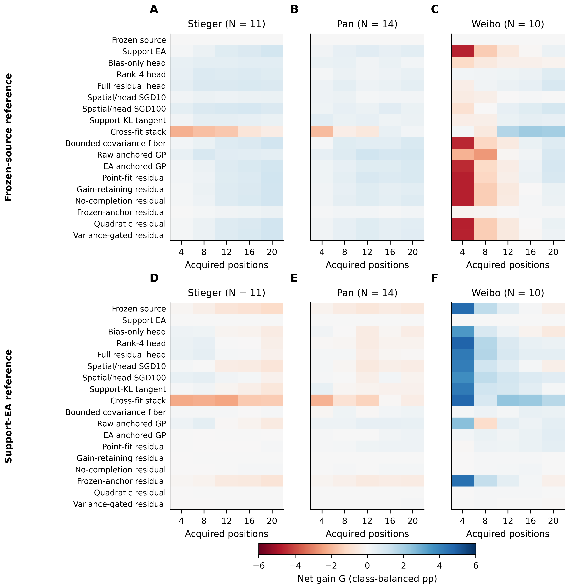
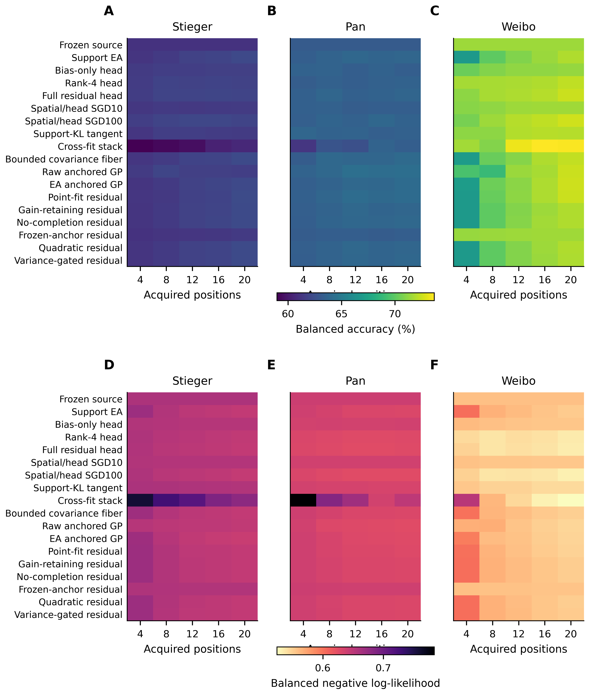
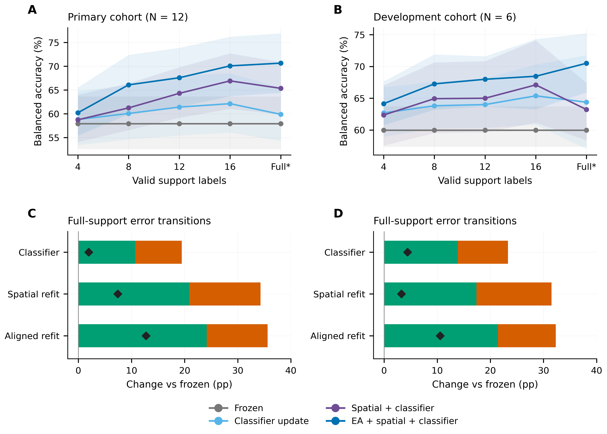
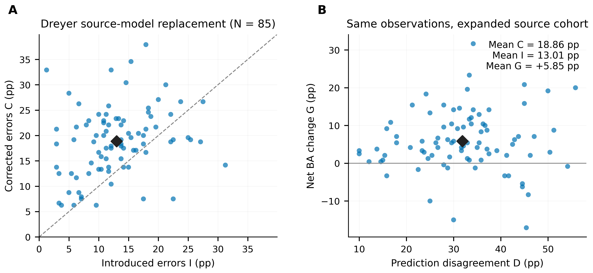

# Supplementary materials

## Error redistribution across conventional and neural motor imagery EEG recalibration

Ziyuan Zhu, Sihao Liu and Haoyang Yu

This supplement retains the cohort-specific processing, all scheduled methods and budgets, scoring-reference sensitivities, original inference families and the separate source-model extension. New intervals use the common participant-bootstrap analysis and are distinguished from historical endpoint intervals.

## Supplementary methods

### Cohort partitions, temporal units and information access

The main calibration analysis contains five separately evaluated cohorts and 56 dataset participants: Kumar primary 12; BNCI2014-001 nine; Stieger historical test 11; Pan 14; and Weibo ten. Kumar's six development participants remain a separate analysis role. The source-model extension uses 85 Dreyer participants. Method, budget, session, seed and scoring-reference rows are repeated observations of these participants.

| Cohort and role | Source information | Support budget and boundary | Query definition |
| --- | --- | --- | --- |
| Kumar primary 12; development six separately | Each participant's session 0/runs 0–1: 40 training labels; run 2: 20 source-validation labels | First run of each of five later sessions; first 4/8/12/16 valid labels or full run, 19/20 labels | Subsequent whole runs; identical ordered queries across methods and budgets |
| BNCI conventional evaluation, nine | First recording day/runs 1–4: 96 hand-imagery labels | Second day/run 1: first 20 chronological hand trials; four remainder trials withheld | Second day/runs 2–6: 120 hand trials per participant, 60 per class |
| Stieger neural evaluation, 11 historical test | Four-dataset EEGNet source training; 40 separate Stieger training-reference participants for feature references | First 4/8/12/16/20 acquired positions, including rejected trials | Complete later physical runs after the position-20 boundary run |
| Pan neural evaluation, 14 | Same neural source checkpoints and fixed references | First 4/8/12/16/20 acquired positions | Fixed trials after the position-20 boundary in published trial order |
| Weibo neural evaluation, ten | Same neural source checkpoints and fixed references | First 4/8/12/16/20 acquired positions | Fixed trials after the position-20 boundary in published trial order |
| Dreyer source-model extension, 85 | BNCI-only S9 versus BNCI-plus-Yang S60; source-only checkpoint selection | Zero target-calibration labels | Same 80 hand-imagery task trials per participant for both source models |

BNCI and Kumar query signals did not estimate alignment references. Neural query statistics did not update source or feature references. Chronological prefixes retained their observed class composition. A support prefix with one true class remained eligible where the recorded implementation supported it. Target labels were not sampled from later queries to balance or replenish calibration inputs.

Kumar's 18 identifiers had six sessions each. Development identifiers were sub-1, sub-4, sub-7, sub-10, sub-13 and sub-16. The primary cohort contained the other twelve. Of 7,200 exported left/right events, 7,156 supplied complete five-second windows; the 44 incomplete windows crossed recording ends and were excluded without padding. The fixed original query set included 360 source-query and 3,930 later-session query trials. Thirty partial target-query windows were excluded in its original construction. All 18 participants supplied complete five-target-session endpoints for the four conventional methods at all five scheduled budgets. Fourteen of the 90 full-support runs supplied 19 valid labels; the remaining 76 supplied 20. Thus `full` is retained as the final budget label rather than universally relabeled B20.

Kumar source-validation examples were used for the archived source-model selection where applicable; they were not included in the conventional CSP/LDA fits analyzed here. Each later session reset to its source/current-support definition; labels revealed in earlier target sessions did not accumulate into later-session fitting.

BNCI's initial electrooculogram calibration objects were excluded from MI-run numbering. The one-based original MAT trial-start sample preceded the class cue by 500 samples at 250 Hz. Its source-day runs 5–6 did not enter fitting; run 6's source-query partition was retained outside the target endpoint. Support was the first 20 chronological left/right observations from target-day run 1. The other four observations of that run were withheld, and later runs supplied the common query set. All original trial identities, artifact flags and assigned roles were retained. No artifact-marked trials were excluded in this evaluation: flags occurred in 87 source-fit, 17 support and 94 query observations.

The Stieger allocation contained 40 training-reference, 11 development-validation and 11 historical test participants. The analyzed historical test partition supplied 105 sessions; Pan supplied 28 sessions and Weibo ten. Three source seeds produced 315, 84 and 30 session–seed evaluations. Stieger queries required at least 20 valid trials and five examples per true class in an eligible complete run. Invalid calibration trials consumed their original acquired positions. The mean number of valid Stieger support examples at 20 acquired positions was 15.53; Pan and Weibo supplied 20. Pan and Weibo used the trial order supplied with their public releases rather than an asserted physical-run chronology. Previous development exposure of the neural evaluation cohorts is retained in the retrospective study interpretation.

### Signal processing and decoder definitions

| Evaluation | Referencing and channels | Epoch and sampling | Recorded conventional/neural implementation |
| --- | --- | --- | --- |
| Kumar | Common average, 22 EEG channels | Cue-anchored 5 s; 512→128 Hz; 22×640 values in volts | Four-component CSP with Ledoit–Wolf regularization and log-power features; LDA automatic shrinkage |
| BNCI conventional | Recorded reference, first 22 EEG channels; EOG excluded | Cue [0,4) s at 250 Hz; continuous-run filtering | Four-component NumPy CSP; covariance and LDA shrinkage 0.1 |
| Stieger/Pan/Weibo neural | Common average, fixed 11-channel montage | Crop [0.25,1.25) s after task anchor; 128 Hz; 11×128 inputs | EEGNet source representation and 18 saved calibration configurations |
| Dreyer source-model extension | Common average, fixed 18-channel montage | Cue-relative [0.5,2.5) s crop from a six-second context; 160 Hz; 18×320 inputs | Broadband EEGNet; fixed S60-versus-S9 source comparison |

All four paths used fourth-order 8–30 Hz bidirectional Butterworth filtering. Kumar filtering occurred within complete trial windows. BNCI conventional filtering occurred within continuous runs. Neural calibration used the original trial's [0,1.5) s task-relative context; the task/feedback anchor in Stieger occurred 2 s after cue onset. Channels were temporally demeaned, followed by division by each trial's joint channel–time root-mean-square amplitude. Insufficient-duration, nonfinite and zero-energy trials were rejected under the fixed input contract.

The neural calibration montage was FC3, FC4, C5, C3, C1, Cz, C2, C4, C6, CP3 and CP4, in that order. EEGNet used eight temporal filters, a 16-channel depthwise spatial stage, a depthwise-temporal/pointwise stage, ELU nonlinearities and pooling to 64 features and two logits [@lawhern2018]. Source training used BNCI2014-001, Cho2017, Lee2019 MI and PhysioNet MI [@tangermann2012; @cho2017; @lee2019; @goldberger2000]. Seeds 20261018/19/20 selected 39/30/45 source-training epochs. Each epoch comprised 64 steps at batch size 64. Adam used learning rate 0.001, β=(0.9,0.999), ε=10⁻⁸, zero weight decay and training dropout 0.25. Replacement sampling selected dataset, participant, observed class and trial. Target configurations retained their recorded initialization, selected fitting modules and native anchors, with batch-normalization and dropout in evaluation mode.

The complete neural method inventory is `frozen`, `support_ea`, `head_bias`, `head_rank4`, `head_full`, `sgd10`, `sgd100`, `r3_protected`, `r4_xfit_select_stack`, `r8_fiber_bounded`, `r9_raw_anchored`, `r9_ea_anchored`, `profile_map`, `profile`, `profile_no_completion`, `profile_frozen_anchor`, `profile_quadratic` and `profile_variance_gate`. Human-readable labels organize the recorded implementations; method keys preserve their provenance. The comparison concerns their saved prediction behavior. Complete configuration receipts provide the fitting definitions and numerical settings.

### Three support-alignment implementations

The conventional component contrast follows the sequence frozen CSP/LDA, LDA-only updating, full CSP/LDA refitting and alignment before full refitting. LDA-only refits the decision rule on source plus support while retaining source CSP. Full refitting re-estimates CSP and LDA on exactly the same source/support union. Its increment beyond LDA-only consequently includes both the new spatial representation and the classifier fitted in that representation.

Kumar alignment represents the common-average-referenced signal in 21 orthonormal coordinates. Each domain reference is the arithmetic mean of trial sample covariances, estimated from the 40 source-training trials or current support prefix. Multiplication by that domain reference's inverse square root whitens the signals. Aligned source and support then enter the same CSP/LDA fit, and target queries use the fixed support-domain transform. Source-validation and target-query observations do not estimate either reference.

BNCI conventional alignment uses the recorded reference, separate source/support covariance estimates and fixed 0.1 covariance/LDA shrinkage in its versioned NumPy implementation. The aligned fit receives the same 96 source and 20 target labels as the other updating fits. It supplies an independent dataset-specific CSP component comparison; BNCI's use elsewhere as a neural training source remains explicit.

Neural alignment acts in the ten-dimensional effective subspace of its 11 common-average channels. Trial covariances are trace-normalized, averaged over valid support inputs and shrunk as 0.95 times the mean covariance plus 0.05 times its isotropic covariance. Whitening of that support reference is followed by recoloring to a fixed source reference [@he2020; @rod2019]. Feature-reference means and whiteners, where required, came from 40 Stieger training-reference participants and 396 sessions. Only valid inputs within each session's first 20 acquired positions entered these feature references. Participants, their sessions and valid support trials received equal hierarchical weights; feature covariance used 0.1 shrinkage. No target queries updated these references.

The alignment operation therefore retains its recorded covariance estimator, channel space and source/support information within each evaluation. Budget curves describe these complete processing paths. They do not isolate a covariance-estimator effect across different acquisitions or decoder implementations.

### Class-balanced prediction transitions

All target tasks have two labels. With \(w_j=1/(2n_{y_j})\), corrected mass C is the weighted sum of query observations changing from incorrect under reference a to correct under method m; introduced mass I is the reverse. Disagreement D=C+I and net gain G=C−I exactly reproduce class-balanced label disagreement and the paired BA difference. We compute transitions before session/seed averaging. Their denominator is the entire class-balanced query set, not just the reference's errors or correct predictions. Values in percentage points are 100 times the stored fractions.

Frozen source decoding is the principal scoring reference within each cohort. Conventional component contrasts additionally compare Full with LDA-only and EA with Full. The neural sensitivity analysis scores the same stored predictions relative to support alignment. Changing a scoring reference changes the measured transition pair without changing any method's training, fitted anchor or prediction rule.

For Kumar, each participant endpoint equally averages five target-session metrics. BNCI has one target recording per participant. For neural calibration, sessions are averaged equally within participant/source seed and the three seeds are averaged equally within participant. Dreyer source-model endpoints average the three source seeds within each participant. Cohort means assign equal weight to participants. These rules preserve the original treatment of query-rich and query-poor sessions.

For participant i, define within-summary cancellation as 2min(C_i,I_i). The cohort-level identity is

\[
\overline{D}-|\overline{G}|=
\operatorname{mean}_i[2\min(C_i,I_i)]
+\operatorname{mean}_i|G_i|-|\operatorname{mean}_iG_i|.
\]

The first term includes opposing transitions present after averaging a participant's sessions and source seeds. It therefore describes cancellation within the participant summary, including cancellation across repeated recordings. The second term captures net changes of opposite sign across participants. Component fractions divide by cohort-mean D; D=0 yields an undefined ratio retained as missing. Both identity checks use full-precision fractions before display rounding.

The common neural descriptive frame includes 16 non-anchor configurations for each of three cohorts, or 48 cohort/configuration cells at the 20-position budget. Complete 17-non-reference and all-18-configuration frames are supplied alongside it. These cells are repeated summaries of the same 35 participants. Their medians and interquartile ranges describe configuration behavior rather than an enlarged independent sample.

### Statistical scope and historical endpoint families

The new common analysis uses pointwise participant-percentile intervals from 10,000 resampling vectors per cohort, random seed 20261029. Methods, budgets and references within a cohort share participant-index vectors. Intervals condition on the archived session/seed summaries and fitted source models. The code supplies intervals for C/I/D/G, BA/reference BA and cancellation quantities. For ratio intervals, bootstrap draws with zero disagreement remain missing; each output records its effective valid-draw count. No new p-values or cross-cohort pooled effects are estimated.

The original Kumar full-minus-frozen contrast retained its primary role; full-minus-LDA-only retained its secondary role. Its historical pointwise participant-bootstrap intervals coexist with a later four-test Holm-adjusted exact sign-flip family: full-minus-frozen, full-minus-LDA-only and LDA-only-minus-frozen in the 12-person cohort, and full-minus-frozen in the ten-person amplitude-restricted subset. The saved unadjusted p values are 0.01953125, 0.01025390625, 0.26123046875 and 0.076171875; Holm values are 0.05859375, 0.041015625, 0.26123046875 and 0.15234375. Those tests retain observed magnitudes and enumerate participant signs under a sign-symmetric null. The historical intervals are pointwise rather than family-adjusted.

Kumar's previously reported EA, budget and phase analyses used exploratory pointwise intervals with 10,000 draws and seed 42. BNCI's Full-minus-LDA-only comparison was the single fixed primary contrast; Full-minus-frozen, LDA-only-minus-frozen and EA-minus-Full formed a separate three-test secondary Holm family. Its exact tests enumerate 512 sign assignments; historical intervals use 10,000 participant draws, seed 20261027, and numeric participant order 1–9. New unified intervals are labeled separately from these preserved endpoint analyses.

The archived neural formal-stage comparison table preserves three roles: 12 primary BA contrasts (four profile-centered comparisons in each cohort), 24 secondary ablation contrasts (four controls, BA and NLL, in each cohort), and 180 additional unadjusted secondary entries. A distinct subsequent matched-residual mechanism family contains 18 comparisons: one residual-versus-point-fit contrast over six outcomes in three cohorts, with its own Holm adjustment. The 18-comparison family does not replace the 24-entry formal-stage ablation family. Original contrast roles, tests, intervals and adjustment columns remain in the machine-readable source tables [@holm1979].

Additional saved diagnostics use their own definitions. Neural probability movement is the ordinary query fraction satisfying |p_m(1|x)−p_EA(1|x)|≥10⁻⁴. A recorded negative-transfer session has method BA more than 10⁻¹² below its matched alignment-reference BA. Neither diagnostic is substituted for class-balanced C/I or recalculated against every fitting anchor. NLL and Brier scores retain their recorded probability floor and scoring conventions.

### Source-model extension without target calibration

The extension compares two completed source models evaluated on the same 85 Dreyer participants [@dreyer2023]. Of 87 listed participants, identifiers 17 and 41 were excluded by the fixed electrode-order eligibility rule. Each retained person supplied 80 trials, 40 per hand, from the first two acquisition runs. S9 used nine BNCI participants; S60 used the same nine plus 51 Yang participants [@yang2025]. Their eligible training inventories contained 2,592 and 33,183 trials. The source models used 18 channels, common-average referencing, 8–30 Hz broadband filtering, a two-second 160-Hz crop and trial-wise root-mean-square normalization. Dreyer's crop extends into the acquisition's feedback interval; this extension evaluates the recorded task-EEG input definition.

The fixed broadband/tail-min-recall checkpoint rule used source validation. Full trajectories received 5,120 updates, with three final source seeds and source-only selected checkpoint durations. The new C/I calculation pairs S60 and S9 predictions by participant, source seed and original trial ID: 20,400 query rows per condition. Each seed receives class-balanced transition weights, then seeds are averaged within participant. This analysis uses the same 85 people as the underlying source-comparison studies; different objectives, checkpoint rules or model configurations do not add independent participants. The source-model extension remains outside the calibration-budget axis and all main calibration cohort means.

### Reproducibility and source-record boundaries

Raw EEG access follows each original dataset's conditions. The analysis package supplies the saved labels/predictions or verified participant-transition summaries, source hashes, configuration identities and executable calculations. Original exclusion rules and ordered query identities are retained. The calculation verifies C−I=BA difference and C+I=D before aggregation and at the reported summary levels. Source models are reused without new training or inference. Research-ethics and consent information concerns the original acquisitions and is recorded dataset by dataset in the article's declarations and source documentation.

## Supplementary results

### Conventional pipelines and separately evaluated development participants

**Table S1. Full-support conventional pipeline summaries.** C and I use frozen CSP/LDA as the scoring reference. Kumar's final support run contains 19 or 20 valid labels; BNCI uses exactly 20. The six Kumar development participants retain their original development role. Values and new pointwise intervals are regenerated from the saved trial labels and predictions.

| Cohort | Role | Pipeline | BA, % | C, pp | I, pp | D, pp | G, pp [95% interval] |
| --- | --- | --- | --- | --- | --- | --- | --- |
| BNCI | Main | Aligned full refit | 77.50 | 14.72 | 7.78 | 22.50 | +6.94 [+3.24, +11.76] |
| BNCI | Main | Classifier only | 71.67 | 3.24 | 2.13 | 5.37 | +1.11 [−0.46, +2.96] |
| BNCI | Main | Frozen | 70.56 | 0.00 | 0.00 | 0.00 | +0.00 [+0.00, +0.00] |
| BNCI | Main | Full refit | 71.85 | 5.56 | 4.26 | 9.81 | +1.30 [−1.76, +3.98] |
| Kumar | Dev. | Aligned full refit | 70.51 | 21.42 | 10.88 | 32.30 | +10.53 [+5.21, +15.73] |
| Kumar | Dev. | Classifier only | 64.37 | 13.85 | 9.45 | 23.30 | +4.40 [−1.71, +11.44] |
| Kumar | Dev. | Frozen | 59.97 | 0.00 | 0.00 | 0.00 | +0.00 [+0.00, +0.00] |
| Kumar | Dev. | Full refit | 63.22 | 17.37 | 14.13 | 31.50 | +3.25 [−0.83, +7.14] |
| Kumar | Main | Aligned full refit | 70.66 | 24.17 | 11.45 | 35.62 | +12.72 [+6.61, +19.12] |
| Kumar | Main | Classifier only | 59.89 | 10.70 | 8.75 | 19.46 | +1.95 [−0.97, +5.08] |
| Kumar | Main | Frozen | 57.94 | 0.00 | 0.00 | 0.00 | +0.00 [+0.00, +0.00] |
| Kumar | Main | Full refit | 65.36 | 20.85 | 13.43 | 34.28 | +7.42 [+2.64, +12.42] |

Complete 4/8/12/16/full-support results for both Kumar cohorts are in `tables/cohort_summary.csv`. Session-level and participant-level records retain query pairing and actual support counts. Matched classifier, spatial and alignment operation contrasts at every available budget are in `tables/component_summary.csv` and `tables/component_participants.csv`.

### Complete neural configuration results

**Table S2. All neural configurations at twenty acquired positions, relative to the frozen source.** Every recorded configuration is included. Complete five-budget tables, both scoring references and pointwise intervals are supplied in `tables/cohort_summary.csv`; participant records are in `tables/participant_metrics.csv`. Descriptive row labels identify existing configurations; exact implementation keys are retained in the method inventory and machine-readable tables.

| Cohort | Configuration | BA, % | C, pp | I, pp | D, pp | G, pp |
| --- | --- | --- | --- | --- | --- | --- |
| Pan | Frozen source | 63.18 | 0.00 | 0.00 | 0.00 | +0.00 |
| Pan | Bias-only head | 63.36 | 1.26 | 1.08 | 2.35 | +0.18 |
| Pan | Full head | 63.77 | 2.43 | 1.83 | 4.26 | +0.60 |
| Pan | Rank-4 head | 63.61 | 2.02 | 1.60 | 3.62 | +0.43 |
| Pan | Gain-retaining residual | 63.83 | 6.70 | 6.05 | 12.75 | +0.65 |
| Pan | Frozen-anchor residual | 63.35 | 0.46 | 0.30 | 0.76 | +0.17 |
| Pan | Point-fit residual | 64.11 | 6.88 | 5.95 | 12.83 | +0.93 |
| Pan | No-completion residual | 63.94 | 6.77 | 6.01 | 12.79 | +0.76 |
| Pan | Quadratic residual | 63.83 | 6.70 | 6.05 | 12.75 | +0.65 |
| Pan | Variance-gated residual | 63.88 | 6.76 | 6.06 | 12.82 | +0.70 |
| Pan | Protected spatial | 63.55 | 3.51 | 3.14 | 6.65 | +0.37 |
| Pan | Cross-fit stack | 63.36 | 5.80 | 5.62 | 11.42 | +0.18 |
| Pan | Bounded geometry | 64.07 | 6.98 | 6.08 | 13.06 | +0.89 |
| Pan | EA anchored residual | 64.11 | 7.00 | 6.07 | 13.07 | +0.93 |
| Pan | Raw anchored residual | 64.25 | 5.25 | 4.18 | 9.43 | +1.07 |
| Pan | Spatial/head SGD10 | 63.36 | 0.76 | 0.58 | 1.35 | +0.18 |
| Pan | Spatial/head SGD100 | 63.60 | 3.42 | 3.00 | 6.42 | +0.42 |
| Pan | Support alignment | 63.82 | 6.70 | 6.06 | 12.76 | +0.64 |
| Stieger | Frozen source | 61.10 | 0.00 | 0.00 | 0.00 | +0.00 |
| Stieger | Bias-only head | 61.72 | 2.03 | 1.41 | 3.44 | +0.62 |
| Stieger | Full head | 61.97 | 3.36 | 2.49 | 5.84 | +0.87 |
| Stieger | Rank-4 head | 61.85 | 2.85 | 2.10 | 4.95 | +0.75 |
| Stieger | Gain-retaining residual | 62.25 | 9.51 | 8.36 | 17.87 | +1.15 |
| Stieger | Frozen-anchor residual | 61.45 | 0.80 | 0.45 | 1.25 | +0.35 |
| Stieger | Point-fit residual | 62.29 | 9.74 | 8.55 | 18.28 | +1.19 |
| Stieger | No-completion residual | 62.26 | 9.53 | 8.37 | 17.91 | +1.16 |
| Stieger | Quadratic residual | 62.25 | 9.51 | 8.36 | 17.87 | +1.15 |
| Stieger | Variance-gated residual | 62.25 | 9.49 | 8.34 | 17.83 | +1.15 |
| Stieger | Protected spatial | 61.52 | 3.66 | 3.24 | 6.90 | +0.41 |
| Stieger | Cross-fit stack | 60.67 | 6.55 | 6.97 | 13.52 | −0.43 |
| Stieger | Bounded geometry | 62.27 | 9.46 | 8.30 | 17.76 | +1.17 |
| Stieger | EA anchored residual | 62.20 | 9.54 | 8.45 | 17.99 | +1.10 |
| Stieger | Raw anchored residual | 61.67 | 6.50 | 5.93 | 12.43 | +0.57 |
| Stieger | Spatial/head SGD10 | 61.49 | 0.95 | 0.56 | 1.50 | +0.39 |
| Stieger | Spatial/head SGD100 | 61.96 | 4.30 | 3.44 | 7.74 | +0.86 |
| Stieger | Support alignment | 62.21 | 9.45 | 8.34 | 17.79 | +1.11 |
| Weibo | Frozen source | 71.54 | 0.00 | 0.00 | 0.00 | +0.00 |
| Weibo | Bias-only head | 71.33 | 0.85 | 1.06 | 1.90 | −0.21 |
| Weibo | Full head | 72.49 | 3.04 | 2.09 | 5.12 | +0.95 |
| Weibo | Rank-4 head | 72.26 | 2.54 | 1.83 | 4.37 | +0.72 |
| Weibo | Gain-retaining residual | 71.94 | 5.02 | 4.62 | 9.64 | +0.40 |
| Weibo | Frozen-anchor residual | 71.60 | 0.46 | 0.40 | 0.87 | +0.06 |
| Weibo | Point-fit residual | 72.52 | 5.81 | 4.83 | 10.65 | +0.98 |
| Weibo | No-completion residual | 71.91 | 5.00 | 4.62 | 9.62 | +0.37 |
| Weibo | Quadratic residual | 71.94 | 5.02 | 4.62 | 9.64 | +0.40 |
| Weibo | Variance-gated residual | 71.87 | 5.07 | 4.74 | 9.81 | +0.33 |
| Weibo | Protected spatial | 72.03 | 3.29 | 2.80 | 6.08 | +0.49 |
| Weibo | Cross-fit stack | 73.58 | 4.32 | 2.27 | 6.59 | +2.04 |
| Weibo | Bounded geometry | 72.31 | 5.40 | 4.62 | 10.02 | +0.77 |
| Weibo | EA anchored residual | 72.54 | 5.76 | 4.76 | 10.52 | +1.00 |
| Weibo | Raw anchored residual | 72.48 | 4.74 | 3.80 | 8.54 | +0.94 |
| Weibo | Spatial/head SGD10 | 71.55 | 0.66 | 0.65 | 1.31 | +0.01 |
| Weibo | Spatial/head SGD100 | 72.59 | 3.91 | 2.86 | 6.77 | +1.05 |
| Weibo | Support alignment | 71.91 | 4.97 | 4.60 | 9.57 | +0.37 |

### Source-model replacement

The separate source-stage comparison uses the fixed broadband/tail-min-recall S60-versus-S9 models. Frozen-source BA was 58.3186% under S9 and 64.1716% under S60. Corrected, introduced, total-disagreement and net-gain contributions were 18.8627, 13.0098, 31.8725 and +5.8529 percentage points. Total cancellation was 81.6364%. Of the 85 participants, 71 had positive net changes and 14 had negative changes. These participant endpoints average three fitted source seeds. The new transition decomposition is descriptive and does not replace the original weaker-class-recall endpoint.

The selected prediction archive contains all 40,800 rows of the two fixed model conditions (20,400 each), with participant, seed, trial ID, true label and both logits. `evidence/source_extension/SELECTION_RECEIPT.json` identifies its complete 979,200-row parent archive, parent SHA-256, exact selection and source commit. The executable analysis recomputes transitions from these logits and checks them against the independently recovered 85-participant table.

## Original dataset ethics and consent documentation

This article analyzes released, coded records without new recruitment, contact, intervention or re-identification. The statutory secondary-use basis is Article 32(1) of Guo Wei Ke Jiao Fa [2023] No. 4 [@nhc2023]. Original acquisition documentation and secondary-analysis declarations are kept distinct.

| Dataset | Original acquisition record used for documentation |
| --- | --- |
| Kumar | Kumar et al. and the NEMAR release [@kumar2024; @kumar2024correction; @nemar177]. The acquisition article reports University of Texas at Austin protocol 2020-03-0073 and written informed consent. |
| BNCI2014-001 | BCI Competition IV dataset 2a release protocol and competition account [@tangermann2012]. A dataset-specific approval/consent identifier was not identified in the inspected release protocol; statements concerning the separate ECoG dataset are not attributed to 2a. |
| Stieger | Dataset acquisition and release documentation [@stieger2021]. |
| Pan | Original cross-session EEG acquisition and analysis publication [@pan2023]. |
| Weibo | Original simple/compound limb-imagery acquisition publication [@yi2014]. |
| Dreyer | Original large-cohort EEG acquisition and release publication [@dreyer2023]. |

The source-trained neural decoders also used released BNCI2014-001, Cho2017, Lee2019 and PhysioNet MI records [@tangermann2012; @cho2017; @lee2019; @goldberger2000]; their source labels and model identities are inherited from the fixed source-training artifacts. These uses do not constitute new participant recruitment. The national exemption statement does not assert a new institutional approval or committee-issued waiver.

## Machine-readable tables and reproducibility

| File | Analysis unit and purpose |
| --- | --- |
| `tables/participant_metrics.csv` | Class-balanced participant/method/reference/budget summaries; main, development and source-extension roles remain distinct. |
| `tables/cohort_summary.csv` | Separate cohort means, pointwise intervals, participant directions and cancellation components; no pooled effect. |
| `tables/component_participants.csv` | Participant-paired adjacent conventional update operations. |
| `tables/component_summary.csv` | Component contrasts across all available conventional budgets and cohorts. |
| `tables/session_metrics.csv` | Available conventional query-session transition records, with actual label counts. |
| `tables/component_session_metrics.csv` | Session-level conventional component transitions. |
| `tables/neural_paired_contrasts.csv` | Neural reference-path comparisons across all three cohorts and five acquisition budgets. |
| `evidence/neural/comparisons.csv` | Original formal-stage comparison roles and tests, without changing their adjustment families. |
| `evidence/legacy/` | Original endpoint/statistical-family records retained separately from the new common reanalysis. |
| `evidence/INPUT_MANIFEST.json` | Input identities, immutable source commits, paths and SHA-256 hashes. |

Run `python analysis/analyze_integrated.py` to regenerate the complete tables and new pointwise intervals. `python analysis/check_analysis.py` checks numerical identities, preserved source records and agreement with independently recovered summaries. `python figures/plot_integrated.py` regenerates the eight scientific figures from the included plotting inputs. Run `python build_support_materials.py`, `python assemble_manuscript.py`, `python build_supplement.py` and `python build_documents.py` in that order to render the author documents. The analysis and scientific plotting scripts use local records and do not train models, submit computing jobs or upload data. Exact dependencies are listed in `requirements-analysis.txt`.

## Supplementary figures

{width=95%}

**Figure S1. Complete neural net-gain grid under two scoring references.** All eighteen configurations, five acquired-position budgets and three cohorts are retained. Top row uses the frozen-source reference and bottom row uses support alignment as a scoring sensitivity reference. Colours show class-balanced net BA change in percentage points on the same symmetric scale. The scoring reference does not replace any configuration's native fitting anchor. The 540 configuration–cohort–budget–reference summaries reuse the original participants and source seeds.

{width=95%}

**Figure S2. Complete neural accuracy and probability-score profiles.** All eighteen configurations and five acquired-position budgets are shown for each cohort. Top row reports participant-equal balanced accuracy and bottom row balanced negative log-likelihood. Rows retain the same method order as Figure S1. These scores use the archived probabilities and participant/session/seed averaging; NLL is a probabilistic prediction score rather than a direct calibration-error estimate. Higher accuracy and lower NLL are preferable within their separately scaled rows.

{width=95%}

**Figure S3. Primary and previously exposed Kumar development cohorts.** A–B: full four-action BA curves, with pointwise participant-bootstrap intervals, are displayed separately for the 12-person primary cohort and six-person development cohort. Full support is 19/20 valid labels. C–D: full-support corrected and introduced mass relative to frozen CSP/LDA; black diamonds mark net BA change. The development participants retain their original role and are not added to the primary inferential sample. Update actions and colours match Figure 2.

{width=95%}

**Figure S4. Prediction redistribution after source-model replacement.** A: participant-level corrected and introduced class-balanced error mass when replacing the nine-person source model with the 60-person source model under the recorded broadband/tail-min-recall comparison. The dashed line marks equal corrected and introduced mass. B: total disagreement and net BA change for the same 85 Dreyer participants. Black diamonds indicate cohort means after averaging the three fitted seeds within participants. This is a separate zero-target-calibration extension: the two models are trained on different source configurations and evaluated on matched external observations. The error-transition decomposition is retrospective and introduces no new hypothesis test.

## References
