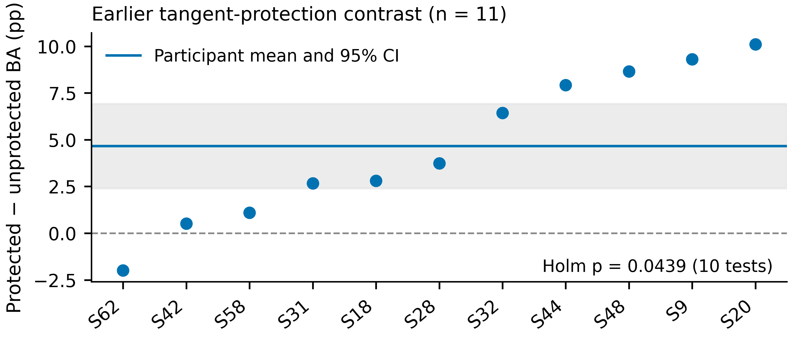

# Supplementary Materials

## Evidence-Retaining Functional Calibration for Few-Trial Motor Imagery EEG Decoding

Ziyuan Zhu, Sihao Liu and Haoyang Yu

## S1. Statistical families and data hierarchy

This supplement preserves the complete archived primary BA family and the additional exploratory mechanism family. Participants are the inference units within each cohort. Sessions are averaged within seed and participant, then seeds within participant. The 11/14/10 participant counts are not replaced by the 315/84/30 session–seed counts. Confidence intervals are pointwise percentile participant-bootstrap intervals; their nominal coverage is not multiplicity-adjusted. Primary tests use the archived analysis seed20261026; the new 18-test family uses20261029. Both use10,000 bootstrap draws and exact two-sided sign flips.

**Table S1. All12 archived primary BA comparisons.** Effects are in percentage points.

| Cohort | Comparison | n | ΔBA (pp) | 95% CI (pp) | Exact p | Holm p (12) |
| --- | --- | --- | --- | --- | --- | --- |
| holdout | ERFC vs ea | 11 | 0.04138 | [-0.017342650050870937, 0.10489067071466282] | 0.23438 | 1.00000 |
| holdout | ERFC vs spatial_sgd100 | 11 | 0.29125 | [-0.2844995699039521, 0.9010806706776812] | 0.39160 | 1.00000 |
| holdout | ERFC vs r9_ea_anchored | 11 | 0.05669 | [-0.1134798600472176, 0.23847174351485562] | 0.56543 | 1.00000 |
| holdout | ERFC vs matched_map | 11 | -0.03830 | [-0.16256481464050654, 0.08633799346302315] | 0.57617 | 1.00000 |
| pan2023 | ERFC vs ea | 14 | 0.01190 | [-0.09523809523809586, 0.15476190476190438] | 1.00000 | 1.00000 |
| pan2023 | ERFC vs spatial_sgd100 | 14 | 0.23810 | [-0.6190476190476191, 0.9880952380952348] | 0.60217 | 1.00000 |
| pan2023 | ERFC vs r9_ea_anchored | 14 | -0.27381 | [-0.5595238095238145, 0.011904761904759007] | 0.11816 | 1.00000 |
| pan2023 | ERFC vs matched_map | 14 | -0.27381 | [-0.5595238095238121, -0.023809523809522774] | 0.09497 | 1.00000 |
| weibo2014 | ERFC vs ea | 10 | 0.02381 | [-0.07142857142857117, 0.14285714285714235] | 1.00000 | 1.00000 |
| weibo2014 | ERFC vs spatial_sgd100 | 10 | -0.65476 | [-2.3095238095238124, 0.5714285714285683] | 0.51562 | 1.00000 |
| weibo2014 | ERFC vs r9_ea_anchored | 10 | -0.59921 | [-1.3571428571428579, 1.1102230246251565e-15] | 0.13281 | 1.00000 |
| weibo2014 | ERFC vs matched_map | 10 | -0.58333 | [-1.0476190476190494, -0.1547619047619131] | 0.04688 | 0.56250 |

**Table S2. All18 newly conducted exploratory matched-MAP tests.** Fraction and BA effects use percentage points, whereas NLL uses nats. Holm adjustment covers all18 rows.

| Cohort | Outcome | n | ERFC − MAP | 95% CI | Exact p | Holm p (18) |
| --- | --- | --- | --- | --- | --- | --- |
| holdout | BA (pp) | 11 | -0.03830 | [-0.16197, +0.08572] | 0.57617 | 0.57617 |
| holdout | Balanced NLL (nats) | 11 | 0.00045 | [+0.00010, +0.00071] | 0.03418 | 0.17090 |
| holdout | Introduced errors (pp) | 11 | -0.74658 | [-0.86104, -0.63952] | 0.00098 | 0.01367 |
| holdout | Corrected errors (pp) | 11 | -0.78488 | [-0.93173, -0.62772] | 0.00098 | 0.01367 |
| holdout | Probability updates (pp) | 11 | -83.94967 | [-86.79386, -80.76922] | 0.00098 | 0.01367 |
| holdout | Negative-transfer sessions (pp) | 11 | -27.03660 | [-32.86108, -21.33018] | 0.00098 | 0.01367 |
| pan2023 | BA (pp) | 14 | -0.27381 | [-0.55952, -0.01190] | 0.09497 | 0.28491 |
| pan2023 | Balanced NLL (nats) | 14 | 0.00162 | [+0.00087, +0.00243] | 0.00049 | 0.00732 |
| pan2023 | Introduced errors (pp) | 14 | -0.71429 | [-0.91667, -0.51190] | 0.00024 | 0.00391 |
| pan2023 | Corrected errors (pp) | 14 | -0.98810 | [-1.16667, -0.80952] | 0.00012 | 0.00220 |
| pan2023 | Probability updates (pp) | 14 | -84.79762 | [-91.22619, -77.85714] | 0.00012 | 0.00220 |
| pan2023 | Negative-transfer sessions (pp) | 14 | -17.85714 | [-26.19048, -9.52381] | 0.00391 | 0.03125 |
| weibo2014 | BA (pp) | 10 | -0.58333 | [-1.04762, -0.16667] | 0.04688 | 0.18750 |
| weibo2014 | Balanced NLL (nats) | 10 | 0.00347 | [+0.00092, +0.00756] | 0.00977 | 0.05859 |
| weibo2014 | Introduced errors (pp) | 10 | -0.69048 | [-1.00000, -0.38095] | 0.00391 | 0.03125 |
| weibo2014 | Corrected errors (pp) | 10 | -1.27381 | [-1.75000, -0.84524] | 0.00195 | 0.01953 |
| weibo2014 | Probability updates (pp) | 10 | -84.82540 | [-90.03968, -79.44444] | 0.00195 | 0.01953 |
| weibo2014 | Negative-transfer sessions (pp) | 10 | -13.33333 | [-30.00000, +0.00000] | 0.25000 | 0.50000 |

## S2. Computational scope

**Table S3. B20 component timings.** Residual fitting starts after feature extraction. Query timing covers additional residual/profile evaluation per1000 already encoded queries. These times exclude support-EA covariance estimation, neural encoding and IO. All18 methods and five budgets are retained at full precision in r10_method_budget_summaries_verified.csv.

| Cohort | Method | Residual fit (ms) | Incremental prediction (s/1000) |
| --- | --- | --- | --- |
| holdout | profile | 1.7458 | 1.5843 |
| holdout | profile_map | 1.8380 | 0.0536 |
| holdout | r9_ea_anchored | 20.3397 | 0.1178 |
| holdout | support_ea | 3.3192 | 0.0009 |
| pan2023 | profile | 1.0722 | 1.5565 |
| pan2023 | profile_map | 1.7047 | 0.0479 |
| pan2023 | r9_ea_anchored | 18.2765 | 0.1034 |
| pan2023 | support_ea | 3.2545 | 0.0009 |
| weibo2014 | profile | 1.0965 | 1.6642 |
| weibo2014 | profile_map | 1.8016 | 0.0467 |
| weibo2014 | r9_ea_anchored | 16.1421 | 0.3347 |
| weibo2014 | support_ea | 2.6180 | 0.0005 |

## S3. Implemented configuration and comparators

**Table S4. Recorded settings and method-name mapping.** “ERFC” is the manuscript name for the unchanged archived profile algorithm, not a new data run. Kernel amplitude and retained-gain allowance have different roles.

| Parameter | Value |
| --- | --- |
| Source seeds | 20261018, 20261019, 20261020 |
| Selected source epochs | 39, 30, 45 |
| Input channels × samples | 11 × 128 |
| Band-pass / sampling | 8–30 Hz / 128 Hz |
| Task-relative crop / filter context | 0.25–1.25 s / 0–1.5 s |
| Source feature dimension | 64 |
| Reference group / sessions | 40 participants / 396 sessions |
| Kernel / amplitude | Linear plus intercept / 0.3 |
| Regularization λ / allowance c | 1 / 0.1 |
| UID nugget / probability floor | 10⁻¹⁰ / 10⁻¹² |
| Newton / bracket / root budgets | 60 / 32 / 12 |
| Probability-update threshold | Absolute change ≥10⁻⁴ |

| Archived implementation | Displayed meaning |
| --- | --- |
| frozen | Frozen source decoder |
| support_ea | Support-only alignment anchor |
| head_bias | Bias-only head |
| head_rank4 | Rank-four head |
| head_full | Full head |
| sgd10 | 10-step spatial SGD |
| sgd100 | 100-step spatial SGD |
| r3_protected | Protected tangent predecessor |
| r4_xfit_select_stack | Cross-fitted selection/stacking |
| r8_fiber_bounded | Bounded geometric predecessor |
| r9_raw_anchored | Raw-anchor kernel residual |
| r9_ea_anchored | EA-anchor kernel residual |
| profile | ERFC |
| profile_map | Matched MAP residual |
| profile_no_completion | ERFC without null completion |
| profile_frozen_anchor | ERFC with frozen-source anchor |
| profile_quadratic | Quadratic profile approximation |
| profile_variance_gate | Variance-gated residual |

The source checkpoint and input-contract hashes are retained in evidence/source-f0-receipts-proofs.json, evidence/main_method_protocol_verified.json and the source manifests. The source-only selected epochs are39,30 and45 for the three seeds, rather than the maximum candidate length80. The exact channel order is FC3, FC4, C5, C3, C1, Cz, C2, C4, C6, CP3, CP4. At smaller budgets, quality-rejected positions are not replenished. In Stieger, the filter context is anchored to feedback onset2s after the cue. Pan/Weibo retain public-release trial order rather than an asserted verified physical chronology.

## S4. Related development evidence

These analyses document the development context and are not independent replications of ERFC. The earlier geometry contrast concerns a different method pair; its four-percentage-point improvement is not substituted for the main ERFC-versus-alignment contrast. Cohorts were reused during development. Interrupted source experiments are not treated as completed confirmatory endpoints.

**Table S5. Scope of related development analyses.** Full restored source tables are included in tables/ where available.

| Analysis | Scope | Result |
| --- | --- | --- |
| Protected vs unprotected tangent calibration | Earlier exploratory Stieger comparison; n=11 | ΔBA +4.6589 pp; 95% CI [2.3965, 6.9094]; Holm p=0.0439 (10-test family) |
| Spatiotemporal adaptation evaluation | Repeated-development Pan cohort; n=14 | 12 primary BA comparisons; none positive after original 24-test multi-metric adjustment |
| Bounded geometric adaptation | Repeated-development cohorts | 40 primary comparisons; none passed Holm adjustment |
| Anchored residual development | Repeated-development cohorts | 24 primary comparisons; none passed Holm adjustment |
| Controlled mechanism pilot | Eight training-side pilot participants | Six pilot comparisons; none passed Holm adjustment; predeclared stop condition triggered |
| Spatial-persistence pilot | Same training-side pilot group; n=8 | Primary NLL interaction 5.64×10⁻⁶; 95% CI [−2.37×10⁻⁵, 3.33×10⁻⁵]; exact p=0.703125 |

{width=90%}

**Figure S1. Earlier exploratory protected-tangent comparison.** Each point is one participant. The mean is+4.6589 percentage points with the original pointwise95% interval[2.3965,6.9094]; the original20,000-draw participant bootstrap and exact sign-flip analysis yielded Holm-adjusted p=0.0439 in a10-test family. This historical contrast is neither ERFC's main accuracy result nor an independent confirmation.

## S5. Reproducibility and provenance

**Table S6. Reproduction inputs and operations.**

| Item | File/operation |
| --- | --- |
| Primary archived report and participant summaries | evidence/r10/reports/report.json and participant_metrics.csv |
| Restored-source hash ledger | evidence/main_download_proofs.json |
| Original primary comparison family | tables/r10_primary_comparisons_verified.csv |
| Additional paired effects and independent units | tables/r10_exploratory_matched_map_mechanisms.csv and r10_exploratory_paired_values.csv |
| Paired mechanism reproduction | python research/analyze_main.py |
| Original data-derived figures | python figures/plot_figures.py |
| Main manuscript assembly | python assemble_manuscript.py |
| Word/PDF rendering | python build_documents.py |

The plotting program uses Matplotlib3.10.8 and reads the numerical tables. It produces editable-text SVG, vector PDF,600dpi RGB PNG and LZW-compressed TIFF. The workflow is an original schematic; no generated EEG traces or invented participants are drawn. Source licenses apply to the raw EEG repositories. The reproducibility package supports numerical reanalysis and figure regeneration; rerunning source-model training additionally requires the original EEG data and research code.
