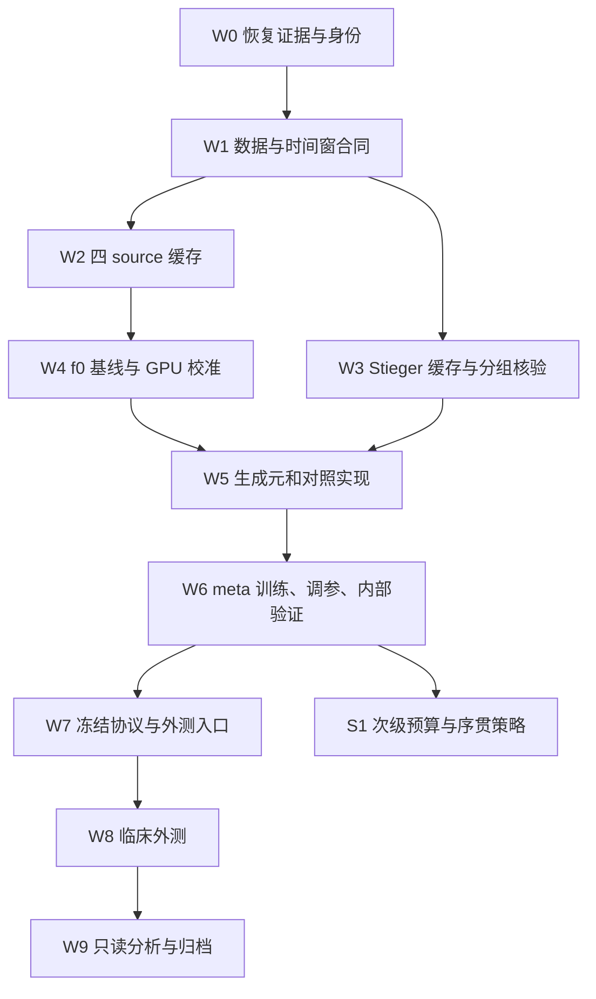

# Work 执行任务：第三篇论文的独立研究流水线

本文件是待 Work 执行的工程与实验任务书，不是本轮已经执行的训练日志。本轮只恢复证据、研究方法、编制计划和轻量检查工具；不下载 EEG、不启动模型训练、不访问服务器、不修改论文 1/2 或旧 v1 包。

## 0. 权威文件、实现边界与完成定义

研究参数、统计主假设、对照定义和数据资格以根目录 **EXPERIMENT_PROTOCOL.md、METHOD_SPEC.md、REFERENCE_METHODS.md、DATA_AUDIT.md 和 DATA_REGISTRY.json**为权威。本文件定义实施顺序、模块接口、产物和验收。参数发生冲突时，先统一这几份文件并产生新协议哈希，不能让训练脚本自行选择一个版本。

旧包本轮恢复审计路径为 `p3_workflow_sources/paper3_pretrain_20261018`，最终交接包内目录名为 `legacy_baseline_v1`，恢复后已按归档校验。交接中的旧包只能作为基线实现和历史软件验证证据。其 13 个软件测试和 9 个合成 job 不代表真实 source 模型已经训练完成。Work 的第一步必须实际检查预期原档、manifest、checkpoint 和 COMPLETE receipt；不能根据计划文件把任务标成完成。

**主线：四个稳定 source 训练 f0；Stieger 的 40 名训练、11 名调参、11 名内部测试参与者用于学习和检验空间生成元；HS-Stroke v6 是主要临床外测。** Stieger 的最终已发布参与者清单须先核验，40/11/11 的具体 ID 在任何方法结果产生前固定，三组以生物个体隔离。论文主算法为源数据学习的 r 维空间生成元参数化，目标 20 个实际采集的校准 trial 只更新 θ 和分类头。矩阵指数通常产生全秩更新，不能称为 rank-r adapter。门控/序贯策略与 4/8/12/16/20 曲线属于次级研究，不进入主算法的必要依赖。

本交付真正可运行的新增轻量命令是 `tools/check_work_contract.py`。下文 `p3work` 命令和模块是 **Work 需要实现的接口规范，目前没有这些科研入口，也没有新算法实现**。禁止把接口规范误写为训练成功。

完成本项目意味着：通过原生数据 schema 关口；实现且验证方法和强对照；在已冻结协议下完成预定训练/外测；归档逐 trial 预测及完整成本；用只读分析生成可复算表图。显著提升不是完成判据，负结果必须保留。

## 1. 任务依赖图



W2 与 W3 的下载/CPU 准备可在磁盘和内存预算允许时并行。W4 的 f0 训练不使用 Stieger。W5 的数学和软件实现可以用合成张量先验证，但真实 meta 训练必须等待 W3、W4 产物通过验收。S1 不得拖延或改变已冻结的主比较。

## 2. 分任务工作包

### W0 — 恢复、只读核查与独立工作目录

输入为旧包、论文 1/2 当前研究状态资料和此次交接文档。为 P3 建立独立代码/结果根目录，记录归档文件 SHA-256、每个导入文件 SHA-256、旧包版本、源码 commit（如有）、恢复时间和用途。保留原包，后续修改只发生在新分支/目录。

在未来 Work 已获服务器访问授权的环境中，只读登记已有任务、GPU 占用、可用 RAM/磁盘和持久卷路径。不能停止论文 1/2 进程，不能把 P3 输出放进 P1/P2 的 processed/run 目录。若当前环境无服务器入口，先完成本地代码和合同工作，远程任务标记为 `NOT_STARTED_NO_EXECUTION_SURFACE`，不虚构训练进度。

输出：`provenance/origin.json`、`provenance/files.json`、`status/tasks.json`。验收：每一项“已完成”都有真实文件和验证记录；不存在把历史 dry-run、计划或合成结果升级成真实训练的状态转换。

### W1 — 数据、单位、事件和窗口合同

为每个数据版本登记 DOI/官方对象 ID、版本、许可、下载清单、原档校验、任务筛选、事件语义、原生通道、单位、坏通道、采样率、trial 维度、真实 recording/run/session 身份、保留顺序与排除规则。未知值写 `null` 和证据缺口，不填推测值。

先依据与长短候选窗无关的原始生物身份、通道和任务资格冻结 Stieger roster，再按协议规则生成 40/11/11 参与者清单。只有这份清单中的 meta-train 元数据可决定时间窗；不能先按长窗是否够长筛人，再决定谁进训练组。原始合格身份不足 62 时按 EXPERIMENT_PROTOCOL 记录明确的分组修订，不捏造 ID；后续窗口 QC 不补换参与者，逐人记录可用 episode 数及缺失。W3 复用这个已冻结 split，仅物化缓存与验证隔离，不重新分组。

优先核验以下会改变研究设计的事实：

- Stieger 必须从原生 BCI MAT 保留 `tasknumber/runnumber/trialnumber/targetnumber/time`。主线 `tasknumber == 1` 才是 horizontal 任务，`targetnumber == 1` 为右、`== 2` 为左。MOABB 1.7.2 简单左/右筛选会混入 2D 任务且丢 run 边界，不能直接作为这条主线的 adapter。
- Stieger 区分 cue 与 feedback/task anchor。最终 anchor、context 和 crop 以 EXPERIMENT_PROTOCOL 为准。长 context 对较早结束 trial 的筛选比例必须报告，不能用后续静息/补零补足，更不能只保留易或难 trial 而不说明。
- 默认候选为 task/feedback anchor 后 context `[0,3)`、crop `[0.5,2.5)`；若 meta-train 原始元数据的合格窗口覆盖未达到协议门槛，备选为 context `[0,2)`、crop `[0.5,1.5)`。覆盖分母、汇总方式与排除理由均须按 EXPERIMENT_PROTOCOL 先固定；采用参与者平均保留率至少 80%、每人左右类排除率差绝对值再等权平均不超过 10 个百分点的门槛，并输出每人/每 session 分布。选择只用 meta-train 元数据，不看 meta-val、Stieger 内部测试、HS 或 Wang 反向改窗。若转短窗，所有 source/meta 数值缓存和 f0 都按新窗重建/重训，不能保留旧 3 秒模型再补零迁就。
- HS 主输入用 source MAT。作者变量名 `run_id` 在部分转换脚本里实际枚举的是 trial，不能直接作为物理 run。必须分别保存 `source_record_id`、`physical_run_id`、`provider_trial_index` 和原生数组索引。物理 run 无证据时为空。若原 trial 数组顺序经独立证据核实为 acquisition order，可按协议使用前 20 个校准 trial 与后续完整 original-trial 块；仅数组索引递增本身不构成这种证明；不可随机切 trial，也不可把数字 session 序号变成未经证实的日期。
- HS 原生 EEG 是 V；部分作者 derivatives 乘成 µV，且可能拼接 run。不要照搬其目标数据上拟合的 autoreject/min-max，也不要用 derivatives 猜原 run 边界。
- Cho 可用于 f0 的 subject-disjoint source LODO；在原始时间顺序恢复前，不能默认把其按类别重建的 Raw 用作序贯 meta episode。

输出：原档 inventory、`adapter_audit.json`、`window_coverage.json`、版本化信号合同、保留/排除事件清单。验收：每个选中事件可以追溯至原档索引；精确左右手映射；没有未知标签推断；没有 silent montage 插值或单位假标；缺失时序不会触发随机 trial 分割的“补救”。

### W2 — 四 source 的统一缓存

保持 BNCI2014_001、Cho2017、Lee2019_MI、PhysionetMI 四库为 main f0 source。Lee 保留 `train_run=True, test_run=False, resting_state=False`；Physio 使用 `imagined=True, executed=False`，只将单侧左/右手 MI 纳入模型，对明确双手/双脚 MI run 记录跳过。四库已发布编号合计 224 仅是适配器计数，真实纳入人数、trial 数和生物身份独立性由实际审计决定。

统一通道顺序：`FC3, FC4, C5, C3, C1, Cz, C2, C4, C6, CP3, CP4`。保留原档/全通道元数据，数值缓存保存所选 11 通道。精确核对每个 run 的存在性及坏通道。信号为 V、先按同一 11 通道 CAR，再按冻结窗滤波/重采样，进入模型前按每 trial 各通道去时均值并 joint RMS。零相位滤波的实际输入截止是 context 末端，不是 crop 末端。

按参与者分 shard 保存 NPZ+JSON；完整 run/event UID 不靠文件名临时拼接。缓存键同时绑定原档、adapter、预处理代码、通道顺序、单位、参考、事件锚、context/crop、采样率和软件版本。旧协议处理数组不修改；同原档的新处理结果使用新 cache ID。

### W3 — Stieger 原生缓存与已冻结分组的核验

Stieger 完整发布约 351.01 GB，和 100 GiB 的旧包准备门槛不是同一规模；必须先读官方文件清单、核验容量，再按已固定参与者/文件清单下载并校验。不要在每次 meta episode 读取数 GB MAT，原生文件按 session 或原始 recording 分块解析，生成保留 run/trial 身份的紧凑 clinic11 数值缓存。磁盘预算逐批按待下载 manifest 字节、最大同时解压临时量、新数值缓存、checkpoints 与余量计算；不能沿用 v1 的 100 GiB 阈值放行整套数据。

269,099 是混合任务计数，89,700 是设计推算的左右任务上限；二者都不能填入 `qualified_training_trials`。后者只能由原生 task、label、时间窗和完整性规则实际统计。

引用 W1 在选窗前已经固定的 roster 与 split，记录其规则、种子和 SHA，并核查数值缓存中的同一人所有 session 只属于一个组。冻结窗造成个别参与者缺少合格 episode 时保留原分组身份和排除记录，不从 validation 或 test 补人。meta-train 才能更新 G 或其他 meta 参数；meta-val 才能选 r、ρ 及各方法允许调整的设置；主方法固定 10 inner updates，不能在目标或内部 test 重新选步数。meta-test 只在配置选择后作一次内部检验，不能继续回到它调参。

每个 episode 的拟合前缀与后续 query 使用协议指定的完整 trial 或 run/session 单元。禁止跨 run 窗口重叠、同 event UID 重复、同人跨 meta 组、同一 query 帧出现在 inner-fit。元数据中的日期/采集时钟与 ordinal 均分别保存，缺任何一项不补造。

### W4 — f0 预训练、checkpoint 验真和硬件校准

先运行现有 CPU 数学基线和紧凑 EEGNet 的 source LODO；所有 train/validation 以 subject 隔离，validation 只在 source。旧包源 LODO 用于早停，是开发验证，不是未参与选择的外部测试。

开发首轮保持 v1 的 4 folds ×（CSP+LDA 1 次 + TS+LR 1 次 + EEGNet 3 seeds）= 20 次 fit。完成对应 source LODO 后，全 source final 为 2 次数学基线 + 3 个 EEGNet seed，共 25 次计划 fit。最终外测固定 5 条完整 pipeline（20261018–20261022）；额外两个 seed 各增加 4 个 LODO 和 1 个 final fit，完整 source 阶段为 28 个 LODO + 7 个 final = 35 个 fit，其中 25 条神经网络轨迹，10 次确定性数学 fit。不能另把目标拟合 seed 无意义相乘。EEGNet 最多 80 epoch × 64 optimizer updates，每次采样 64 trials；epoch 不是全数据遍历。全源 EEGNet 的固定长度来自对应 seed 已完成 source LODO 的选择规则。

新增 `f0_receipt.json` 绑定 selected 权重、architecture、输入合同、全部 f0 training UID、源 LODO 选择来源、配置、环境和数值精度。source G 实验只能引用通过 receipt 的 f0。若转换为短窗或信号合同改变，f0 重训；从不同 montage/单位模型载入部分层只能作为另立版本的迁移实验，不能标为同一 incumbent。

GPU UTC 校对和 GPU 运算计时分开，见第 5 节。已有 V1 只验证 CPU resume；新 GPU 环境必须在真实 source 小规模软件检查中验证暂停/恢复、指标和预测重放。这个验证不产生科研比较结论。

### W5 — 生成元主方法和强对照的独立实现

按 METHOD_SPEC 实现：CAR 后投到 10 维子空间；仅由四个 f0 training sources 估计固定参考/whitener；用 r 个源学习、Frobenius 正交、traceless 的 G 构成 M，T=exp(M)，θ 限于半径 ρ；逆白化回 11 通道后使用同一 trial RMS；真实 RMS 用 float64 计算，不加 epsilon/截断；零能量输入按资格规则处理。f0 encoder 固定，目标仅学习 θ 和分类头增量。实际先计算原双 logit 源头，再加 (-δm/2,+δm/2)；BCE 用两个 logits 的差，保存概率用 softmax、类别用 argmax 且平局为 0，不能重排源头权重后把数值改变称为严格 identity。学习 r 个系数不等于 rank-r 矩阵更新。

将实现拆成以下文件，避免把所有逻辑写进训练入口：

| 待实现模块 | 单一职责 | 必须保存/检验 |
|---|---|---|
| `p3work/contracts.py` | 输入、版本、UID 和运行身份 | 不同合同拒绝合并；原档/处理/方法三层哈希 |
| `p3work/adapters/stieger_native.py` | 原生 MAT、task/run/trial/anchor | task==1；左右码；时间长度和排除审计 |
| `p3work/adapters/hs_stroke_native.py` | source MAT、原 trial/recording 身份 | 物理 run 不由 trial index 冒充；V/µV 区分 |
| `p3work/splits.py` | subject meta split 和目标前缀/未来 query | 40/11/11 隔离、固定 query、完整原 trial |
| `p3work/f0_bridge.py` | 无改写导入 v1 f0、版本化 adapter | checkpoint 与完整信号合同一致 |
| `p3work/spatial_geometry.py` | Q、Rref、W、G、matrix-exp、θ 约束 | θ=0 重放、trace/orthogonality、坐标与传感器空间诊断 |
| `p3work/meta_train.py` | 仅 meta-train 的 inner/outer 优化 | 把 inner/outer 更新与 meta-val 选择分开 |
| `p3work/methods/*.py` | head-only、PCT、meta-LoRA、random/unconstrained G 等 | 同 f0、同 target 校准前缀、各方法参数数与更新数 |
| `p3work/adapt.py` | 固定预算目标适应 | 无 target-query 读取、冻结 encoder state 和 BN buffers |
| `p3work/prediction_store.py` | 逐 trial 预测、hash、标签可见记录 | 预测状态及 candidate hash；不覆盖旧预测 |
| `p3work/evaluate.py` | 冻结模型之后的 query 计分 | 分 class G/H、BA、完整参与者分母 |
| `p3work/analysis.py` | 仅加载保存结果生成表图 | 不导入 fit、optimizer 或 dataset 下载入口 |
| `p3work/cli.py` | 干运行计划、分阶段执行与状态 | 默认不下载/训练；按协议和 run-plan 执行 |

必须在真实 EEG 训练前通过针对性的合成张量测试：θ=0 与同 CAR/RMS incumbent 数值一致；traceless/正交条件达到预设容差；θ 投影正确；梯度有限且 inner/outer 关键导数通过小张量检查；r=0/关闭适应确实为 frozen；encoder weights、BatchNorm running buffers 和 dropout 模式在 target 适应中保持固定。只设置 `requires_grad=False` 不足以证明 encoder 完整冻结。

源学习 G、learned additive、random G、无约束空间更新、PCT、meta-LoRA 及 meta-LoRA+PCT 依照 REFERENCE_METHODS 实现并逐项给出实际参数数、优化步数和 source/meta 数据使用。learned additive 是首轮必须保留的最近结构对照；不得只实现一个弱 head-only 就作最终优越性结论。禁止使用目标 query 选择学习率、早停、正则强度、G 方向或候选动作。

### W6 — meta 训练、开发选择与内部检验

meta-train 的 40 人负责梯度；meta-val 的 11 人负责开发选择。参考协方差和 W 只能取 f0 的训练数据，不能从 Stieger val/test 或 HS query 重新估计。病例适应的数据统计如果是方法组成，只能由该病例允许的校准前缀计算并在方法名中明确。

先通过一个 source/meta seed 的工程试运行和计时，再执行预先列出的搜索配置。主方法每个 meta job 为 1000 次 outer update、每次 4 个 episode、每 episode 固定 B20 和 10 次 inner update；每 50 次 outer update 在 meta-val 按协议选择 checkpoint。保留完整 unrolled gradient。outer 损失按 METHOD_SPEC 合并 episode 的全部合法 future trials 后做类平衡损失，不擅自改成等 run 加权。每个对照最多 9 个预登记调参配置，先单 seed 筛查，再 3 seeds 确认；全部强对照和 B* 在外测前冻结。先固定搜索表，再计算预算；不得因为某个临床结果不理想临时扩大搜索。

主目标为固定 20 个实际采集的 cued calibration trials。每个主 query episode 至少 20 个有效 original trials，且每类至少 5 个；资格集合由所有方法共同使用。具体 prefix、缺失/拒收 trial 的计费、类别不足时的处理及 query 定义按 EXPERIMENT_PROTOCOL。默认应保留原顺序，报告不能拟合时的 fallback/失败比例；不能向后挑出 20 个“最容易用”的 trial 而把挑选前消耗的 trial 隐藏。

配置冻结后，在 Stieger 内部 test 11 人执行预定三 seeds 的内部检验并封存全部结果。临床外测扩展至预登记五 pipeline seeds，新增两个 seed 不重新调参。另做 nested 10/20/40 meta 参与者的规模机制时，10 人名单嵌入 20 人、20 人嵌入 40 人，使用同冻结配置、同 outer-update 上限与固定 validation；属于独立消融，不在首轮把全部可选分支一次铺满。若发现方法实现或数据身份错误，记录 amendment；不要把已经看过的 test 重新称为未用过的选择集。内部 test 不能替代 HS 临床外测。

### W7 — 冻结外测协议与保留区

在任何临床 query 报告之前固定：输入合同和窗口、f0 与 G 权重、主方法与全部对照、超参数、20-trial 定义、主比较和主终点、样本资格、session/run/trial 顺序、允许的 target-calibration 访问、seed、统计代码、次级分析列表和运行预算。生成 `freeze.json` 及完整文件 SHA 清单。

HS 等临床数据原档可以在协议允许的阶段提前校验封存；原档已下载不等于模型已评估。label-blind adapter 校验、校准标签访问和最终 query 分析应分别留访问记录。最终 evaluator 不向训练/调参入口返回 query 指标。

冻结是可复核的协议状态，不是新增的行政审批步骤。在已有授权范围内，Work 完成所有技术关口后继续执行；未获得训练/云操作授权的本轮保持 planning-only。

### W8 — 临床执行与不可改写预测

每个参与者/seed 从相同 source 基础状态新建 target adapter，不沿用上一个患者的 optimizer、BN 状态、θ 或统计量。使用已冻结 20-trial 前缀完成适应后，所有待比较方法对相同未来 query 生成并封存预测，再由 evaluator 读取 query 标签计算结果。

先保存 logits/概率、case/trial 身份和实际成本，后生成总体统计。主要单位是参与者，不能把 seeds、sessions 或 trials 当作新增独立患者。按预注册主比较分析 BA，同时保存每 class 的 correction G 与 new error H、recall、fallback/更新率和每人的差异。普通逐 trial G−H 是 accuracy 差，不能不分 class 就替代 ΔBA。

### W9 — 只读分析、论文与静态归档

结果分析必须能仅凭归档重算，不下载数据、不训练模型。每个表/图有来源文件哈希、脚本版本和确定性随机种子。所有失败、负提升和不更新病例保留在分母；不能只报告被 gate 接受的子集或排除变差者。

## 3. 新旧资料的复用规则

| 既有对象 | 可复用部分 | 不能直接复用为主 P3 的部分 |
|---|---|---|
| P1 原始 BNCI/Yang/Dreyer 档案 | 原档、官方/本地 hash、许可、download/clock/label 审计；每个对象仍需新角色登记 | 不能因已存在就自动加入 P3 main source 或临床外测 |
| P1 18 通道缓存 | 可作为旧协议对照的只读证据 | 3 views × 18 × 320、160 Hz、CAR18、marker 6 秒 context 与 `[2,4)` crop、trial RMS 无量纲；不是 P3 clinic11/V/128 Hz 缓存，切通道重采样仍不等价 |
| Yang 原 BDF | 可复用 `data/evt.bdf`、原 hash 与 v3 明确标签/clock 记录 | `?V` 单位和 trigger/MI onset 关系未解；不能假写成 V，也不能把分析参考当已证实 MI onset |
| P2 Kumar 数据和 saved predictions | 可复用公开出处、问题背景、机制对照定义和已发表/投稿结果的溯源 | 不用于第三篇新临床发现的验证集；不能把 P2 5.47 pp 等旧结果计为新方法提升 |
| P3 v1 processed shard | 仅当 source 身份、V、CAR11、通道顺序、窗口、采样率、代码合同和 SHA 完全一致 | 若统一短窗或修改事件锚/预处理，旧数值缓存必须独立保留，新建版本 |
| P3 v1 f0/数学状态 | 真实存在且输入/架构/选择/环境 receipt 通过时可重用 | 旧包里的合成权重不算科研模型；不同输入合同不能无痕继续训练 |
| MIRepNet 等官方权重 | 作为登记了官方预训练语料的额外基线 | 其已见 Physio/Cho/Lee/Dreyer 等库不得再称严格未见；不能替换主 f0 而不更新方法和 overlap 审查 |

Yang 只保留为 optional enhanced-source 分支：单位、锚点和角色全部通过 schema gate，单独构建/训练，且在临床解封前固定该分支。如果关口不通过，main f0 和主论文照常推进，不用 Yang 凑 source 数。

## 4. CLI、状态和产物合同

现有 v1 的真实命令仍是 `python -m p3 --root ... doctor/prep/train/status`；global args 在子命令之前，prep/train 默认 dry-run。不要往原包添加 target 研究入口。

待 Work 实现的新接口建议为：

```text
python -m p3work doctor --protocol ...
python -m p3work audit-data --registry ...
python -m p3work plan --protocol ... --stage source|meta|internal-test|clinical
python -m p3work prepare --plan ... --execute
python -m p3work fit-source --plan ... --execute
python -m p3work fit-meta --plan ... --execute
python -m p3work run-internal --freeze ... --execute
python -m p3work seal --protocol ... --artifacts ...
python -m p3work run-clinical --freeze ... --execute
python -m p3work analyze --predictions ... --freeze ...
python -m p3work status --root ...
```

任何真实 fit 的身份至少包含：protocol SHA、dataset/version/角色、原档和 shard SHA、split/episode ID、window/montage/unit、f0/W/G/方法源码 SHA、hyperparameters、precision、硬件和驱动、全部 RNG、已使用校准 UID 与 query UID、inner/outer update 计数、actual acquired-trial 和 label-access 计数。

每个目标 job 保存：`identity.json`、`candidate_state.pt`、`last_state.pt`、完整 RNG/episode cursor（主方法无动量 GD 记录参数/步数即可；有状态对照另存 optimizer state）、`fit_summary.json`、`query_predictions.npz`、`trial_metadata.json`、`cost.json`、`artifact_manifest.json`、`status.json`。主预测必须同时有两类 logits/概率、预测标签、event UID、source_record/physical_run/session/trial 身份、prediction role、所依赖 candidate/hash、输入合同和可见校准历史摘要。query 标签可由 evaluator 单独保管，不能放进训练函数参数再靠约定“不使用”。

GPU/CPU checkpoint 使用同环境的可信自有状态文件；模型权重、optimizer、随机数、迭代 cursor 和 scheduler（如果使用）必须同步提交。每个阶段的模型 checkpoints 与逐 trial 预测保留，最终论文重算只需读取这些产物。新的模型结构或学习规则仍需要新的 fit；本计划不会承诺所有未来创新都能仅靠旧 logits 完成。

## 5. GPU 校时、计时和分阶段预算

### 5.1 时钟与身份

未来服务器预检保存 UTC、采集时本机 UTC 请求区间、NTP/chrony 状态（可用时）、`monotonic_ns`、GPU 名称/UUID、driver、CUDA/cuDNN、PyTorch、Python、全部 resolved dependencies、TF32/AMP/deterministic 配置。不要通过修改服务器时钟来“修复”日志。UTC 偏差与不确定度如实记录；duration 使用 monotonic，不能用可能跳变的 wall-clock 差值。

PyTorch CUDA 默认异步；只在 Python 发起调用前后读时间不能准确测 GPU 耗时。校准使用 CUDA Event 或显式同步，并同时记录 end-to-end wall time、CPU 处理、数据搬运、验证、压缩和 checkpoint IO。固定 warm-up 段，记录测量段 update 数及 p50/p90；不能将纯 kernel 时间当云账单时长。[官方 2.8 CUDA 文档](https://docs.pytorch.org/docs/2.8/notes/cuda.html)

同 seed 不保证跨 PyTorch/平台/CPU-GPU 精确复现。GPU 型号、驱动或精度变化视为新 runtime 身份；不得把 CPU resume 的旧验证推广为跨 GPU 保证。[官方 2.8 reproducibility 文档](https://docs.pytorch.org/docs/2.8/notes/randomness.html)

### 5.2 工作量清单和估计公式

| 阶段 | 固定工作量/先行上限 | 计时与停止条件 |
|---|---|---|
| 数据 schema 小样 | 先核官方元数据；未来获授权后取预先列出的 source/Stieger/HS 样本对象验证 | 只测格式/覆盖，不能按模型效果挑样本；失败不开始全量下载 |
| source f0 | 三 seed 开发为 20 LODO + 5 final；五 seed 完整为 28 LODO + 7 final，其中 25 条 EEGNet 轨迹，每条最多 5,120 updates | 三 seed 上限 76,800，五 seed 上限 128,000 神经网络 optimizer updates；另计每 epoch 验证与所有数学 fit/IO |
| G/对照工程 smoke | 合成张量和固定少量 meta-train episode | 只验证实现；不算研究结果，不看 meta-test/临床 query |
| meta 搜索 | 先列完整 method×configuration×seed 搜索表；每方法最多 9 个候选，初筛 1 seed、开发确认 3 seeds、最终外测补齐 5 个 pipeline seeds | outer updates、episodes/outer、inner updates 都有显式上限；不能无限自动扩搜索 |
| Stieger 内部 test | 固定 11 人 × 已冻结方法 × 3 source/model seeds × 预注册 episode | 配置已选定再执行；不能重复回调超参数 |
| HS 主要临床外测 | 实际 qualified participants/session × 已冻结方法 × 5 pipeline seeds × B=20 | 数量来自审核清单；不能用下载页面总数替代 qualified sample |
| 次级固定-query曲线 | 同病例/seed 的 B=4/8/12/16/20；B20 已存在时复用已封存预测 | 不重复计 B20 为新独立样本；记录所有 prefix 是否 nested，状态是否允许精确重用 |
| 次级 gate/序贯 | 仅预登记动作、检查次数、每次 fit/audit 和总 trial cap | 与主算法独立预算；到 cap 就保留 incumbent/结束，不能偷偷继续采集直到过界 |

设第 j 条 source 轨迹有 Uj updates、Ej epochs、Vj validation trials，则用实測计算

`T_source = Σj [Uj·t_update + Ej·t_validation(Vj) + t_final_prediction + t_checkpoint_IO] + T_classical + T_preparation`。

meta 阶段必须分清 inner 与 outer：

`U_inner = Σ(method, config, seed) outer_updates × episodes_per_outer × inner_updates`；

`T_meta = Σ [outer_updates × (episode_batch_cost + outer_backward_cost + checkpoint_cost) + scheduled_validation_cost]`。

主方法单个 meta job 为 4,000 episodes、40,000 inner gradient steps。9 个设置的单 seed 筛查为 9 jobs；冻结设置后再补 4 个 pipeline seed，最终 P 本身合计 13 jobs、13,000 outer updates、52,000 episodes、520,000 inner gradient steps。这是预定满额工作量，不是已执行数量；learned additive、meta-LoRA/meta-LoRA+PCT 等各自按实际独立 meta jobs 另计，不能藏进 P 的数字。额外 nested10/20 与对称/旋转等消融另列，先完成主方法与强对照再派发。

使用测得的完整 episode cost 估计，不能把 outer update 当普通一次小网络 update。GPU 内存需实測 unrolled inner-loop 的峰值，包含二阶/跨步图；不能只按 θ 参数很少推断显存很小。实际费用按服务器真实费率乘完整占用时间，加持久盘/原档费用，列区间和余量，不承诺一个未经实測的小时数或金额。

所有预算由 `plan` 在启动前展开成 job manifest；记录预估值、阶段实际值和剩余上限。已完成且身份一致的模型不重复拟合；不影响主比较的可选增强/门控先留待基础任务完成。

### 5.3 校准成本的三本账

分别保存：①实际 acquisition 的 cued calibration trials 和可核验采集时长；②算法访问过标签的 distinct event UID；③CPU/GPU 计算耗时。MI 任务的类别经常由实验 cue 本身给出，不能把已采集的数据通过软件隐藏标签就宣称减少了患者采集成本。

固定-query 的 B 曲线如果统一把 query 放在最大预算前缀之后，必须说明它比较的是使用标签/前缀信息的变化，不能默认把未用于拟合的中间已采集 trial 算为零成本。没有真实 timestamps/完整协议时，区分实测耗时、按任务时长推算的成本和离线反事实计划；不要用 GPU 计算秒数替代患者校准秒数。

## 6. 失败、恢复与不可悄悄更改的条件

| 情形 | 正确恢复 | 禁止做法 |
|---|---|---|
| 下载中断 | 保留 partial；服务端支持正确 Range 时续传；提交前核大小与官方/local hash | 错误拼接断点、把错误字节数对象标完成 |
| metadata/标签/单位/窗口失败 | 保留原文件与审计；标 `SCHEMA_BLOCKED`；修正式版本后重建对应 cache | 猜标签、猜 µV、补零、随手丢未知 run |
| 同人或相同事件跨组 | 标 `SPLIT_INVALID`；按预定 person/recording 身份修正 split 并换协议版本 | 只更改 subject 名称绕过去重 |
| 半个 epoch/outer-update 中断 | 从最后原子提交的模型/optimizer/RNG/cursor 恢复；未提交段重做并记录重做成本 | 只载权重把 optimizer/RNG 重新初始化仍称精确续跑 |
| GPU OOM | 先保留状态；只使用预先声明的 microbatch/accumulation 方案，或建立新配置 job | 静默缩 batch、少采人/试次、少做更新然后保留旧 run ID |
| GPU/driver/精度变化 | 新 runtime 分支；报告数值一致性范围，必要时从同 source 初始化重跑该比较 | 把跨硬件结果称为已证明位级续跑 |
| COMPLETE 产物 hash 不符 | 标 `INTEGRITY_FAILED`，保留调查 | 覆盖文件或重新训练后假装旧记录仍有效 |
| target 前缀单类/不足/数值失败 | 按事前定义 fallback 或资格规则处理，计入 acquisition 成本和覆盖分母 | 向后看 query 补平衡、按结果剔除失败人 |
| query 在冻结前被用于选择 | 记录 exposure/amendment；对应检验降为 exploratory，另找未触碰的验证 | 删除日志、换 seed 后宣称重新盲测 |
| 阳性/大提升未出现 | 保留预定分析和负结果，评估方法边界 | 加看多个临床版本直到挑出显著结果 |

## 7. 次级序贯策略的独立合同

主方法和 B20 主比较不依赖此模块。如果实施，使用 `FIT → CANDIDATES_FROZEN → PREDICTIONS_SEALED → LABELS_REVEALED → AUDIT_DECISION → NEXT_BLOCK/STOP` 状态机。候选至少包括 frozen incumbent、head-only 和已冻结空间候选。

每个 audit 块在任何标签揭示前保存所有候选的预测和 model/input/hash；块内候选不变。揭标签后计算配对 G/H 及预登记 decision。旧 audit 可在下一轮进入 fit，但重新拟合后的 candidate 必须使用新的未来 audit，不能拿旧预测的证据验证新模型。所有 fit/audit、agreement 和拒收 trial 均按实际 acquisition 规则计入成本。label-reveal receipt 原子保存后才能交给 learner，进程中断后应幂等恢复，不能丢失一次已经发生的标签访问。

固定查验与序贯多次查验用各自正确的不确定性方案和明确假设；少量标签下证据不足时允许保持旧模型。不能未经证明声称 10–40 标签的分布无关安全保证。最终 query 不参与候选生成、停止、gate 参数选择或新一轮拟合。

## 8. 每次 Work 交接必须留下的简短状态

结束一个 Work 阶段时写明：实际完成的 job ID/sha、只计划未执行的 job、当前数据资格和缺口、已访问哪些 dataset/label partition、下一任务和依赖、实际费用/时间、恢复命令、是否改动协议，以及下一个 worker 需要读取的精确文件路径。状态不能只写“训练中”或“结果良好”。

用户后续只做论文统计时，入口应是 `analyze` 及保存预测，默认无任何训练副作用。只有新模型/新数据合同/新问题需要新增实验时，才建立新的协议和训练任务，不覆盖原记录。
